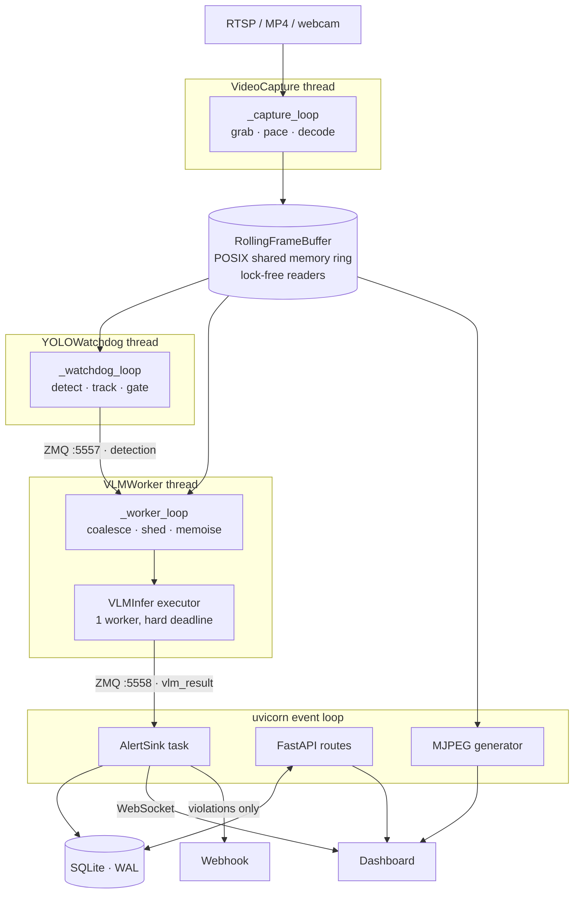
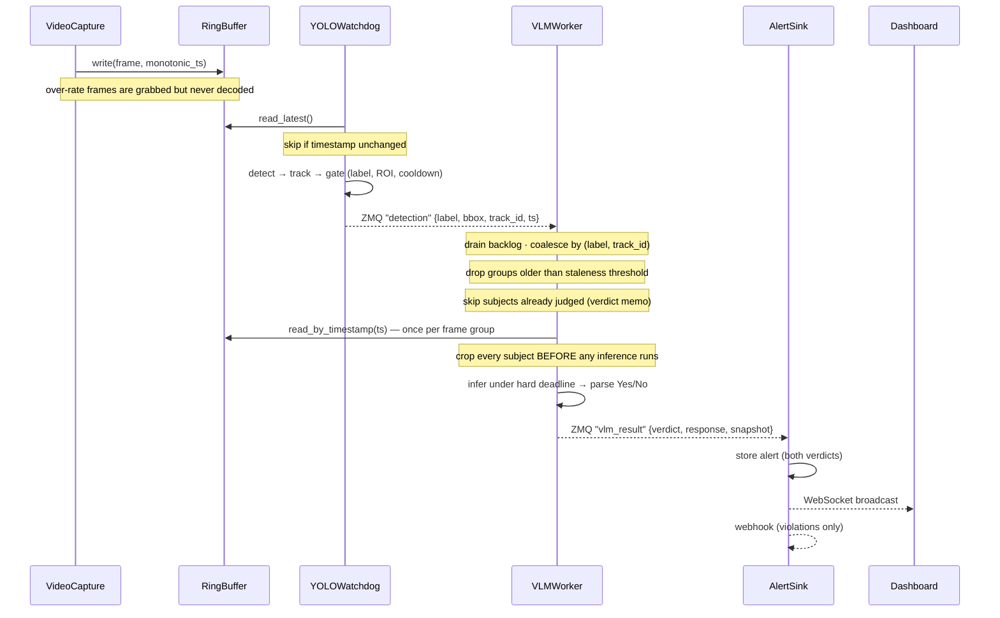

# Eye-Q — Architecture

How the system is built, how a frame becomes an alert, and why the non-obvious decisions were made.

> **Where this fits.** `README.md` is the quickstart. This document is the engineering reference.
> `IMPLEMENTATION.md` is a change-log-shaped record of an earlier rework and predates the current
> batching and tracking code — where the two disagree, this document and the source are correct.
> `PLAN.md` is the original design doc, kept for history.

---

## 1. What Eye-Q is

Eye-Q watches a video source and answers plain-English questions about it — *"is this person bending
over to lift something?"*, *"is anyone in this area without a hi-vis vest?"* — and records an alert
when the answer is yes.

The whole design falls out of one measurement:

| Stage | Model | Cost per call |
|---|---|---|
| Stage 1 | YOLOv8n object detection | **~16 ms** |
| Stage 2 | Moondream2 vision-language model | **~4,200 ms** |

Three orders of magnitude. A VLM cannot look at a 30 FPS video stream; it can barely look at one
frame every eight seconds. So Eye-Q is a **cascade**: a cheap detector looks at everything and a
slow, smart model looks at almost nothing.

```
30 FPS of pixels ──▶ [YOLO: is there a person?] ──▶ ~0.1 FPS of subjects ──▶ [VLM: is this a violation?]
                          runs on everything                                    runs on almost nothing
```

Everything else in this codebase is machinery for deciding what "almost nothing" means — which
subjects are worth a question, which questions have already been answered, and which can be dropped
without missing anything that matters.

**Deployment shape:** a single process, entirely local. No cloud calls, no external services. It runs
on a laptop, and `.env.pi5` is a worked tuning profile for a Raspberry Pi 5.

---

## 2. System shape



### Threads

Four daemon threads plus the uvicorn event loop, all in one process:

| Thread / task | Owner | Entry point |
|---|---|---|
| `VideoCapture-default` | lifespan | [capture.py:236](app/core/capture.py#L236) `_capture_loop` |
| `YOLOWatchdog` | lifespan | [detector.py:410](app/pipelines/detector.py#L410) `_watchdog_loop` |
| `VLMWorker` | lifespan | [vlm_worker.py:629](app/pipelines/vlm_worker.py#L629) `_worker_loop` |
| `VLMInfer` (1-worker pool) | VLMWorker | [vlm_worker.py:337](app/pipelines/vlm_worker.py#L337), used at [:724](app/pipelines/vlm_worker.py#L724) |
| `AlertSink` (asyncio task) | lifespan | [alert_sink.py:106](app/services/alert_sink.py#L106) `_consume_loop` |
| uvicorn event loop | `main.py` | [main.py:110](main.py#L110) |

They exist to protect one invariant:

> **A slow VLM must never drop a video frame.**

That is enforced at three independent hops, each of which is non-blocking by construction:

1. **Buffer writes overwrite; they never wait.** The ring buffer has no "full" state — the writer
   advances the head and clobbers the oldest frame ([buffer.py:225-236](app/core/buffer.py#L225-L236)).
2. **ZMQ sends are `NOBLOCK` and drop at the high-water mark.** A backed-up subscriber returns
   `zmq.Again`, the publisher logs it and moves on ([ipc.py:95-100](app/core/ipc.py#L95-L100)).
3. **Inference runs behind a deadline.** `_infer` submits to a single-worker executor and calls
   `future.result(timeout=...)`, so a wedged model wakes the caller on schedule
   ([vlm_worker.py:724](app/pipelines/vlm_worker.py#L724)).

The result is that Stage 2 falling behind degrades *coverage* (fewer questions answered), never
*capture* (the video keeps flowing and the live feed keeps drawing).

### Why two ZMQ endpoints, not one socket with two topics

`:5557` carries `detection` (Stage 1 → Stage 2); `:5558` carries `vlm_result` (Stage 2 → control
plane). They are separate endpoints because **ZMQ sockets are not thread-safe** and the two
publishers live in different threads ([settings.py:102-113](app/config/settings.py#L102-L113)). Each
publisher owns its socket in the thread that uses it; nothing is shared.

The result subscriber is the `zmq.asyncio` variant (`AsyncEventSubscriber`,
[ipc.py:290](app/core/ipc.py#L290)) so the control plane polls without blocking the event loop.

---

## 3. Ownership and lifecycle

**`main.py` is only a CLI.** It translates flags into `EYEQ_*` environment variables and hands off to
uvicorn ([main.py:35](main.py#L35) `_apply_cli_overrides`, [main.py:110](main.py#L110)).

The ordering there is load-bearing. `get_settings()` is `@functools.lru_cache(maxsize=1)`
([settings.py:400](app/config/settings.py#L400)), so **the first call freezes configuration for the
life of the process**. Any override — CLI flag, test fixture, demo script — must be written to the
environment before anything reads settings.

**The FastAPI lifespan owns every component** ([server.py:156](app/api/server.py#L156)). It builds
them in a fixed order and tears them down in exact reverse:

```
startup:   database → buffer → publisher → capture → Stage 1 → Stage 2 → alert sink → sync_rules
shutdown:  alert sink → Stage 2 → Stage 1 → capture → publisher → buffer (close+unlink) → database
```

Single ownership is deliberate, and the docstring at [server.py:1-10](app/api/server.py#L1-L10)
records why: an earlier version split ownership between `main.py` and the lifespan, and the result
was that rules silently stopped reaching the pipeline. Note also that `sync_rules` runs *before* the
first frame is judged ([server.py:181](app/api/server.py#L181)) — otherwise Stage 2 would spend its
first inferences answering no question at all.

`uvicorn` owns `SIGINT`/`SIGTERM` and drives lifespan shutdown; there is no separate signal handling.

**Entry points:**

| Command | What it runs |
|---|---|
| `uv run eyeq` | Full pipeline + dashboard on `:8000` |
| `uv run eyeq --api-only` | Dashboard and API only, no capture or inference |
| `uv run eyeq --no-vlm` | Stage 1 only — detection and live feed, no model load |
| `uv run python demo_cctv.py` | Seeded warehouse-CCTV demo with three pre-built rules |
| `uv run python demo.py` | Stage 1 only in a native OpenCV window |

---

## 4. The workflow: how a frame becomes an alert



### Stage 0 — Capture

[`capture.py:350`](app/core/capture.py#L350) `_run_capture` runs **two independent rates**:

- **Grab pacing** applies to file sources only. A file is paced to its own FPS
  ([`_playback_interval`](app/core/capture.py#L433)) so an MP4 plays back in real time rather than
  blurring past at decode speed. Live sources — device indices, `rtsp://`, `http://` — free-run and
  are consumed as fast as they arrive.
- **Write gating** applies to everything. If less than `1/target_fps` has elapsed, the frame is
  grabbed but **not decoded** ([capture.py:401-403](app/core/capture.py#L401-L403)) — `grab()`
  without `retrieve()` skips the expensive JPEG/H.264 decode entirely. Surviving frames are written
  with a `time.monotonic()` timestamp, which becomes the frame's identity everywhere downstream.

Resilience: EOF triggers an in-session `_rewind()` for seamless looping
([capture.py:445](app/core/capture.py#L445)); connection failures back off exponentially, capped at
30 s and interruptible by shutdown ([capture.py:283-348](app/core/capture.py#L283-L348)); and
`_MIN_SESSION_S = 0.5` stops a source that ends instantly from pinning a core in a reopen spin
([capture.py:262](app/core/capture.py#L262)).

### Stage 1 — Detect, track, gate

[`detector.py:517`](app/pipelines/detector.py#L517) `_process_frame` runs three passes:

1. **Decode** YOLO output, filter by confidence, normalize boxes to 0–1.
2. **Track** — `tracker.update(...)` assigns ids for the whole frame at once
   ([:593](app/pipelines/detector.py#L593)). Frames with no detections still call `update([])` so
   tracks age correctly ([:588](app/pipelines/detector.py#L588)).
3. **Gate** — each detection passes **label → ROI → cooldown**, in that order, each with its own
   counter so `/api/status` can show *why* things were dropped
   ([:624-631](app/pipelines/detector.py#L624-L631)).

Three details are worth understanding before changing anything here:

**Cooldown is per instance, not per label.** The key is `f"{label}#{track_id}"`
([detector.py:621](app/pipelines/detector.py#L621)). Before tracking existed, the key was just
`"person"` — meaning one person in frame suppressed alerts for *everyone else* for the whole cooldown
window. In a warehouse with five workers, four were invisible.

**Display scope is wider than trigger scope.** Every detection above the confidence threshold is
appended to a `deque(maxlen=256)` with a `fired` flag, *regardless* of whether it passed the gates
([detector.py:635-636](app/pipelines/detector.py#L635-L636)). The live feed reads that deque
([`recent_detections`](app/pipelines/detector.py#L282)), so the operator sees the whole scene while
only a fraction of it wakes the VLM.

**Repeated frames are skipped.** If the buffer returns a frame with the same timestamp as last time,
it is dropped without inference and counted as `frames_repeated`
([detector.py:450-454](app/pipelines/detector.py#L450-L454)). Without this, a 6 FPS clip under a
30 FPS watchdog would run YOLO five times on identical pixels.

### Stage 2 — The VLM worker

This is where most of the engineering is. The problem: triggers arrive faster than 8-second
inferences can consume them, so the worker must decide what to skip. It does so in **four layers**,
cheapest first.

**Layer 1 — Coalesce** ([`_collect_batch`](app/pipelines/vlm_worker.py#L663)). Take one blocking
receive, then drain up to 512 queued triggers. Keep only the **newest payload per
`(label, track_id)`** ([:694-702](app/pipelines/vlm_worker.py#L694-L702)), sort newest-first, and cap
at 64. Keying on `label` alone was a real bug: five workers in frame collapsed into a single
judgement, because they all looked like "person".

**Layer 2 — Shed stale** ([:830-837](app/pipelines/vlm_worker.py#L830-L837)). Group events by
timestamp — one timestamp is one source frame — and discard whole groups older than
`vlm_staleness_s`. This happens *before* any frame is fetched or pixel touched, so shedding is
essentially free. **A high `triggers_stale` count is correct load shedding, not a fault.**

**Layer 3 — Memoise verdicts** ([`_rules_to_judge`](app/pipelines/vlm_worker.py#L451)). This is the
main load-control mechanism. A `(track_id, rule_id)` pair is skipped when its answer is still
expected to hold — all of:

- the subject has a stable track id (an untracked detection is nobody in particular);
- the verdict is younger than `vlm_verdict_ttl_s`;
- and the subject has *not* moved away from where it was judged — unless it moved *and* at least
  `vlm_min_rejudge_s` has passed.

That last floor matters. Movement is detected as `bbox.iou(judged_bbox) < rejudge_iou`, and without a
time floor a person simply walking across frame would demand a fresh inference roughly every 0.6
seconds. The governing arithmetic, stated in the settings themselves
([settings.py:274-279](app/config/settings.py#L274-L279)):

```
duty_cycle = subjects × inference_seconds ÷ verdict_ttl_seconds
```

Five subjects at 8 s/inference with a 300 s TTL is a duty cycle of 0.13 — comfortable. Drop the TTL
to 30 s and it is 1.33, and the worker is permanently behind.

**Layer 4 — Prioritise and truncate** ([:869-878](app/pipelines/vlm_worker.py#L869-L878)).
Never-before-judged subjects sort ahead of re-checks, then newest first. Anything past
`vlm_max_instances_per_batch` is deferred and counted as `instances_shed`. The priority order is the
point: a person who just walked into frame is more informative than a re-check of someone already
cleared.

**Then the ordering guarantee.** The frame is read **once per group**, and **every crop is taken
before any inference runs** ([:853-859](app/pipelines/vlm_worker.py#L853-L859)):

```python
frame = self._read_frame(first_event)          # once
crops = [crop_detection_focused(frame, e.bbox) for e in group]   # all of them
for crop in crops:                             # only now do we infer
    ...
```

This is a correctness requirement, not an optimisation. Inference takes seconds; the ring buffer
recycles slots in well under a second. Cropping up front makes the buffer irrelevant by the time the
slow work starts.

**Judging** ([`_judge_instance`](app/pipelines/vlm_worker.py#L897)): convert the crop once
(BGR → RGB → PIL), append `" Answer with only Yes or No."` to the prompt, infer under the deadline,
parse, remember the verdict, save one evidence JPEG per subject (shared across all rules that
subject matched), and publish. A timeout calls `backend.request_stop()` and **abandons the entire
remaining batch** ([:884-889](app/pipelines/vlm_worker.py#L884-L889)) — with a single-worker
executor, continuing would just queue behind a thread that is still wedged.

### Alerting

[`alert_sink.py:125`](app/services/alert_sink.py#L125) `_handle_result` does four things:

1. **Re-file orphans.** If the rule was deleted while its inference was in flight, the alert is
   stored under sentinel `rule_id = 0` rather than dropped
   ([:131-134](app/services/alert_sink.py#L131-L134)).
2. **Store both verdicts.** Violations *and* clears go into the database. A history containing only
   the times the system said "yes" tells you nothing about whether it was looking.
3. **Broadcast the database row**, not the `VLMResult` — the sink re-reads what it just stored,
   grafts on `rule_name` / `label` / `confidence`, and sends that
   ([:153-161](app/services/alert_sink.py#L153-L161)). Live WebSocket cards and paginated history
   therefore render through one code path and can't drift apart.
4. **Fire the webhook on violations only**, as a detached task so a slow endpoint cannot stall the
   sink ([:163-182](app/services/alert_sink.py#L163-L182)).

Per-message exceptions are caught and logged inside the loop
([:121-123](app/services/alert_sink.py#L121-L123)), so one malformed payload can never kill the sink
and silently stop all alerting.

---

## 5. Component reference

### `app/core/buffer.py` — `RollingFrameBuffer`

A circular frame buffer in POSIX shared memory: three segments holding the frame ring
`(capacity, H, W, 3) uint8`, a `float64` timestamp array, and a 2-slot `int64` metadata array
(`write_head`, `frame_count`).

The counters live in shared memory rather than `multiprocessing.Value` because `Value` carries a
POSIX semaphore that `unlink()` cannot release — a genuine resource leak on every shutdown
([buffer.py:69-74](app/core/buffer.py#L69-L74)).

Writers take a lock; **readers are lock-free and stale-tolerant by design**
([buffer.py:15-17](app/core/buffer.py#L15-L17)). A reader that catches a torn moment gets a frame one
slot off, which nothing downstream cares about — and in exchange, a reader can never stall the
writer. Every read returns a `.copy()`, so callers hold real data rather than a view into memory
that's about to be overwritten.

`read_by_timestamp(target, tolerance_ms)` is the lookup Stage 2 uses to recover the exact frame a
detection came from.

Sizing is memory, not frames: 150 frames at 1280×720 ≈ 405 MB; 300 frames at 1080p ≈ 1.77 GB.

### `app/core/capture.py` — `VideoCapture`

Covered in §4. Also worth noting `is_file_source()`
([capture.py:45](app/core/capture.py#L45)): device indices and stream schemes are always treated as
live, and only paths that actually exist on disk get file treatment (real-time pacing and looping).

### `app/core/ipc.py` — ZMQ transport

Two-frame multipart messages: `[topic_bytes, json_payload_bytes]`. `EventPublisher` (PUB, binds,
`NOBLOCK`, `LINGER=0`), `EventSubscriber` (SUB + poller, with `drain()` for backlog collection), and
`AsyncEventSubscriber` (`zmq.asyncio`, for the event loop).

### `app/pipelines/detector.py` — `YOLOWatchdog`

Covered in §4. Two supporting pieces:

**`CooldownGate`** ([:64](app/pipelines/detector.py#L64)) — an opaque-keyed rate limiter. It prunes
expired keys at 512 entries and hard-caps at 4096, degrading by forgetting the entries nearest to
expiry ([:106](app/pipelines/detector.py#L106)). Bounded memory matters here because track ids are
never reused, so the key space grows forever without pruning.

**Runtime mutators** — `update_roi`, `update_target_labels`, `update_cooldown`, `update_confidence`.
These let `sync_rules` retune a running watchdog without a restart (§7).

**Model loading** ([:468](app/pipelines/detector.py#L468)) is lazy, runs a dummy warm-up inference,
and **falls back to CPU** if the accelerator fails — a bad GPU shouldn't take the appliance down.

### `app/pipelines/tracker.py` — `GreedyIoUTracker`

Frame-to-frame identity by greedy IoU matching. Deliberately **not** ByteTrack: ultralytics' tracker
calls `check_requirements()` on `lap` at import time, which attempts a runtime `pip install` — fatal
on an offline appliance ([tracker.py:14-18](app/pipelines/tracker.py#L14-L18)).

- **Matching is within-label only** ([:108-113](app/pipelines/tracker.py#L108-L113)) — a person and
  the forklift they're driving can overlap almost perfectly.
- All candidate pairs above threshold are scored, sorted `(-iou, idx, track_id)` for determinism, and
  claimed best-first. A `claimed` set guarantees **two detections in one frame can never share an
  id** ([:120-133](app/pipelines/tracker.py#L120-L133)).
- Ids are monotonic, unique across labels, and **never reused**. `_evict()`
  ([:154](app/pipelines/tracker.py#L154)) retiring tracks past `max_age_frames` is the only bound on
  memory.
- Returns ids **in input order**, so the caller can `zip` them straight back onto its detections.

The accepted trade-off is stated at [:21-24](app/pipelines/tracker.py#L21-L24): with no motion model,
an occlusion can split one person into two ids. That costs one redundant inference. It never costs a
missed alert — which is the right direction for the error to point.

### `app/core/labels.py` — Prompt / label linting

Pure functions, advisory only, with no role in the runtime pipeline.

- `COCO_CLASSES` — the 80 YOLO classes, served verbatim by `GET /api/labels`.
- A synonym map: `worker`, `staff`, `employee`, `someone`, `pedestrian`, `driver` → `person`;
  `vehicle` → `car` ([:40](app/core/labels.py#L40)).
- An `_AMBIGUOUS` blocklist — `{orange, tie, bear, train, remote, mouse, clock, apple, kite}` are
  never auto-suggested ([:74-76](app/core/labels.py#L74-L76)), because "high-visibility **orange**
  vest" is a rule about people, not fruit.
- `scope_warning()` ([:123](app/core/labels.py#L123)) — when a prompt clearly names a class but the
  rule has no label filter, it explains that the rule will spend its inference budget on trucks and
  pallets. **Non-blocking**: the API attaches it as a `warning` field and the UI offers it as a
  choice.

### `app/pipelines/vlm_worker.py` — `VLMWorker`

Covered in §4. Two more things:

**Focused cropping** ([`crop_detection_focused`](app/pipelines/vlm_worker.py#L154)). The crop is
padded by 15% for context, then everything outside the subject's *own* box is dimmed to 40%
brightness. Without this, a helmeted neighbour standing inside the padding routinely flipped a
bare-headed subject's verdict. The VLM sees the context but knows who the question is about — and it
costs nothing at inference time.

**Frame recovery** ([`_read_frame`](app/pipelines/vlm_worker.py#L771)). Primary lookup is by
timestamp with a 500 ms tolerance. The fallback by `frame_index` **re-validates the timestamp** and
returns `None` on mismatch ([:777-789](app/pipelines/vlm_worker.py#L777-L789)) — see §12, because
`frame_index` is a ring slot, not a frame number.

### `app/pipelines/vlm_backends.py` — Three swappable backends

One `@runtime_checkable` Protocol (`load`, `query`, `request_stop`, `cleanup`, `unload`), three
implementations, chosen by `EYEQ_VLM_BACKEND` through
[`build_backend`](app/pipelines/vlm_backends.py#L642):

| Backend | Mechanism | Use for |
|---|---|---|
| `moondream` (default) | In-process HF model, revision-pinned | Laptop / workstation |
| `transformers` | Any chat-templated vision-to-text HF model | Swapping in Qwen2-VL, SmolVLM, MiniCPM-V |
| `openai_compat` | HTTP to Ollama / llama.cpp / vLLM / SGLang | Quantized models, edge hardware |

All three are local — there is no cloud path in this codebase. `build_backend` returns an
**unloaded** backend deliberately: the consuming thread calls `load()` itself, so model weights land
in the thread that will use them.

Only `TransformersVLMBackend` supports genuine interruption, via a `StoppingCriteria` watching a
`threading.Event` checked per token ([:254](app/pipelines/vlm_backends.py#L254)). On the other two,
`request_stop()` is an honest no-op — Moondream's remote-code wrapper accepts no stopping hook, and
the HTTP backend is bounded by its request timeout instead.

`transformers` is pinned `<4.50` because Moondream's pinned revision depends on APIs removed after
that.

### `app/pipelines/vlm_judge.py` — `BinaryVerdictParser`

Turns free text into a boolean, in three strategies:

1. **First word** — "Yes…" / "No…". Highest confidence (0.95), and the reason the prompt is forced to
   end with *"Answer with only Yes or No."*
2. **Keyword scoring** — with negation handling, so `"is not blocking"` scores negative
   ([:112-120](app/pipelines/vlm_judge.py#L112-L120)).
3. **Default: `False`.**

That default is a policy choice, documented at [:37-43](app/pipelines/vlm_judge.py#L37-L43): an
unparseable response becomes a non-alert. False negatives are recoverable; alert fatigue means the
operator stops looking at the screen, and then nothing works.

### `app/core/roi.py`, `app/core/overlay.py`

`RegionOfInterest` — normalized polygon with ray-casting point-in-polygon; `contains_bbox_center` is
the primary gate.

`overlay.py` — all frame annotation, shared by the live MJPEG preview and the native demo window so
both speak one visual language. Boxes are labelled `person#3 87%`, with a `[TRIGGER]` prefix when the
detection actually fired.

### `app/services/webhook.py` — `WebhookDispatcher`

One shared `httpx.AsyncClient`, per-request timeout, **no retry and no queue by design**
([webhook.py:1-6](app/services/webhook.py#L1-L6)). `dispatch()` never raises; failures are logged and
return `False`. A webhook is a notification convenience, not a delivery guarantee — the database is
the system of record.

---

## 6. Data and contracts

### Wire schemas — `app/schemas/events.py`

All coordinates are **normalized 0–1**, so resolution changes anywhere don't invalidate stored boxes.

| Model | Topic | Notes |
|---|---|---|
| `BoundingBox` | — | `iou()` returns `0.0` for degenerate boxes, so no caller needs a division guard |
| `DetectionEvent` | `detection` | Stage 1 → Stage 2 |
| `VLMQuery` | — | Embedded in the result: which rule asked what |
| `VLMResult` | `vlm_result` | Stage 2 → control plane |

`DetectionEvent.track_id` is **deliberately unconstrained** and defaults to `-1`
([events.py:107-119](app/schemas/events.py#L107-L119)). A publisher with tracking disabled stays wire
compatible, and every per-instance code path degrades gracefully to per-label.

`SystemStatus` is declared but **unused** — `/api/status` hand-builds its dict
([server.py:724-771](app/api/server.py#L724-L771)).

### SQLite — `app/core/database.py`

```
rules    id · camera_id · name · prompt · target_labels(JSON) · roi_json(JSON)
         confidence · cooldown_s · enabled · created_at · updated_at

alerts   id · rule_id → rules(id) ON DELETE CASCADE · camera_id · timestamp
         verdict · raw_response · inference_ms · bbox_json · frame_snapshot
         created_at · track_id · label

cameras  id · name · source · resolution · fps · enabled · created_at
```

Indices on `alerts(rule_id)`, `alerts(created_at DESC)`, `rules(camera_id)`. `journal_mode=WAL` so
the API can read while the sink writes; `foreign_keys=ON`.

**Migrations are additive.** `_migrate_alerts` ([:140](app/core/database.py#L140)) issues idempotent
`ALTER TABLE ... ADD COLUMN` for post-release columns (`track_id`, `label`) — an existing database
upgrades in place without losing history.

**Deleting rules doesn't delete history.** `delete_all_rules` reassigns alerts to the sentinel rule
*before* dropping the rows ([:205-212](app/core/database.py#L205-L212)), because `ON DELETE CASCADE`
would otherwise wipe the entire alert log the moment someone cleared their rules.

### The polarity contract

**"Yes" means violation, and violations render red.** Rules must be phrased so that an affirmative
answer is the thing worth looking at:

- ✅ *"Is this person bending at the waist to lift something?"*
- ❌ *"Is this person lifting safely?"* — inverts the whole UI.

One predicate per rule, one subject per rule. `"Is this person bending over AND not wearing a vest?"`
gives a small VLM two ways to be wrong and no way to tell you which.

---

## 7. Rule propagation

[`sync_rules`](app/api/server.py#L77) runs at startup and synchronously after every rule
create/update/delete, before the HTTP response returns. It pushes the same rule table into two stages
that need it at **different granularities**:

**Stage 2 gets per-rule detail** — each rule's own prompt and its own ROI, registered once per target
label (or under `"*"` if unscoped). Stage 2 can hold N distinct polygons because it evaluates rules
one at a time.

**Stage 1 gets the coarsest filter that satisfies every rule** — the union of all labels, the
*minimum* confidence, the *minimum* cooldown. A single watchdog cannot carry N polygons, and it must
never filter out something that some rule still wants to see.

The subtlest part is the **three-state label scope**
([server.py:124-133](app/api/server.py#L124-L133)):

| Scope | Meaning |
|---|---|
| `None` | Some rule is unscoped → every label triggers |
| non-empty set | Trigger on exactly this union |
| **empty set** | **Nothing triggers** |

The empty case is the one that's easy to get wrong. With no enabled rules there is no question to
ask, so Stage 2 should stay asleep rather than burn inferences nobody asked for — while the detector
keeps running and the live feed keeps drawing. Collapsing "no rules" into "all labels" would make an
idle system the most expensive one.

---

## 8. API and frontend

### Routes — `app/api/server.py`

| Method | Path | Purpose |
|---|---|---|
| `GET` | `/` | Dashboard |
| `GET` | `/api/stream/{camera_id}.mjpg` | Live MJPEG stream |
| `GET` | `/api/stream/{camera_id}/frame.jpg` | Single annotated JPEG (fallback) |
| `GET` | `/api/rules` | List rules |
| `GET` | `/api/labels?prompt=` | COCO vocabulary + suggestions for a prompt |
| `POST` | `/api/rules` | Create rule (returns `warning` if unscoped) |
| `DELETE` | `/api/rules` | Bulk clear — history preserved via sentinel |
| `GET` | `/api/rules/{id}` | Get rule |
| `PUT` | `/api/rules/{id}` | Partial update |
| `DELETE` | `/api/rules/{id}` | Delete rule |
| `GET` | `/api/alerts?limit&offset&rule_id` | Paginated alert history |
| `GET` | `/api/alerts/{id}` | Single alert |
| `GET` | `/api/cameras` · `POST` · `DELETE /{id}` | Camera registry |
| `GET` | `/api/status` | Full pipeline telemetry |
| `WS` | `/ws/events` | Live alert push |

Plus static mounts: `/static` (frontend assets, forced `no-store`) and `/snapshots` (evidence images,
following `settings.snapshot_dir` rather than a hardcoded path).

`/api/status` is the observability surface and exposes every counter that matters: buffer occupancy,
watchdog FPS and per-reason filter counts, active tracks, and the worker's
`triggers_stale` / `triggers_coalesced` / `instances_memoised` / `instances_shed`. `_stats_of`
tolerates a dead component by returning `None` rather than throwing
([server.py:708](app/api/server.py#L708)) — a status endpoint that 500s when a thread dies is useless
exactly when you need it.

### Frontend — vanilla JS, no build step

Four transports, each chosen for a different surface:

| Surface | Transport |
|---|---|
| Live video | **MJPEG** `multipart/x-mixed-replace` in an `` |
| Live video fallback | **Still-JPEG polling** at ~5 FPS (Safari, and stream errors) |
| Alerts | **WebSocket** `/ws/events`, with a 30 s application-level ping |
| Stats | **Polling** `/api/status` every 3 s |
| Rules, history | Plain REST |

The live feed has three layers of resilience, because a blank video panel is the failure users
actually notice:

1. `src` is set in the HTML, not JS, so the feed loads even if `app.js` is cached stale or blocked
   (`frontend/index.html:117-123`).
2. Client-side, an `onerror` handler swaps to snapshot polling, and after 8 s a
   `naturalWidth === 0` check catches the nastier case — a stream that connects but renders nothing
   (`frontend/app.js:75-80`).
3. Server-side, the generator **never goes silent and never dies**
   ([server.py:391-452](app/api/server.py#L391-L452)): it emits a cached placeholder card instead of
   no part, and wraps each frame in try/except with logging backoff. It also opens with a leading
   CRLF, without which Safari won't parse the stream at all.

Overlay drawing dedupes to the newest box per `(label, track_id)` before drawing
([server.py:338-350](app/api/server.py#L338-L350)) — otherwise a stationary person is drawn 30 times
into a smear. And every `cv2.imencode` runs under `asyncio.to_thread`
([server.py:422](app/api/server.py#L422)); encoding inline would stall the event loop and take the
REST API and WebSocket down with the video.

The **scope-warning flow** is the one clever bit of UI: on save, if a rule has no labels, the client
calls `/api/labels?prompt=` and renders an inline choice — *"Watch only person"* (fills the field and
resubmits) or *"Watch every class"* (accepts and resubmits). Guidance at the moment of the decision,
not a validation error afterwards.

---

## 9. Notable implementation ideas

1. **The cascade itself.** Three orders of magnitude of latency arbitrage between a detector and a
   VLM. Everything else follows from it.
2. **Zero-copy shared-memory ring with lock-free readers.** Readers are stale-tolerant, so a reader
   can never stall the writer, so the VLM can never drop a frame.
3. **Four-layer load control** — coalesce, shed, memoise, truncate — with an operator-facing formula
   (`duty_cycle = subjects × inference_s ÷ ttl`) rather than a magic number.
4. **Focused crops.** Dim everything outside the subject's own box so a neighbour can't flip the
   verdict. A correctness fix that costs nothing at inference time.
5. **Crop-before-infer as a correctness guarantee.** Inference outlives buffer slots; crops don't.
6. **Three swappable VLM backends behind one Protocol.** The same appliance runs an in-process HF
   model on a laptop and a quantized model over HTTP on a Pi, with one env var between them.
7. **Conservative verdict parsing.** Three strategies defaulting to `False`, because alert fatigue is
   a worse failure than a missed alert.
8. **Measured, counter-intuitive defaults.** `vlm_device` defaults to `cpu` because Moondream2
   measured 5.6 s on CPU versus 6.1 s on MPS, with ~10 s more load time. Device detection uses a
   *functional* probe (`torch.zeros(1, device="mps")`), not a capability flag, because the flag lies.
9. **Prompt-side latency engineering.** `max_tokens=24` and a forced Yes/No suffix — each extra token
   is another sequential forward pass through the model.
10. **Both verdicts stored, the DB row broadcast.** History stays interpretable, and live and
    historical views can't diverge.
11. **Graceful degradation everywhere it counts:** GPU warm-up failure → CPU; rule deleted mid-flight
    → sentinel; malformed message → logged, sink survives; camera drops → backoff and reconnect;
    file ends → seamless loop.

---

## 10. Configuration

All settings are `pydantic-settings` fields with the prefix `EYEQ_`, readable from the environment or
a `.env` file. Every field carries a `description` explaining its rationale — `settings.py` is the
authoritative configuration documentation.

**Source and buffer**

| Variable | Default | Bounds |
|---|---|---|
| `EYEQ_DEFAULT_SOURCE` | `0` | RTSP URL, file path, or device index |
| `EYEQ_FRAME_WIDTH` | `1280` | 160–7680 |
| `EYEQ_FRAME_HEIGHT` | `720` | 120–4320 |
| `EYEQ_TARGET_FPS` | `30` | 1–120 |
| `EYEQ_BUFFER_CAPACITY` | `150` | 10–3000 (≈405 MB at 720p) |

**IPC**

| Variable | Default |
|---|---|
| `EYEQ_ZMQ_ENDPOINT` | `tcp://127.0.0.1:5557` |
| `EYEQ_ZMQ_RESULT_ENDPOINT` | `tcp://127.0.0.1:5558` |

**Stage 1 — detection**

| Variable | Default | Notes |
|---|---|---|
| `EYEQ_YOLO_MODEL` | `models/yolov8n.pt` | |
| `EYEQ_YOLO_CONFIDENCE` | `0.25` | 0–1 |
| `EYEQ_YOLO_IMGSZ` | `640` | 416 is ~2.1× faster on ARM CPU; no gain on MPS |
| `EYEQ_DETECTION_COOLDOWN_S` | `5.0` | Per *instance* when tracking is on |
| `EYEQ_WATCHDOG_FPS` | `30.0` | ≤120 — **the main CPU lever** |

**Tracking**

| Variable | Default | Notes |
|---|---|---|
| `EYEQ_TRACK_ENABLED` | `true` | `false` reverts to one-alert-per-label |
| `EYEQ_TRACK_IOU_THRESHOLD` | `0.2` | 0.45 measured 4.2 ids/person; 0.2 gives 2.0 |
| `EYEQ_TRACK_MAX_AGE_FRAMES` | `60` | |

**Stage 2 — VLM**

| Variable | Default | Notes |
|---|---|---|
| `EYEQ_VLM_BACKEND` | `moondream` | `moondream` \| `transformers` \| `openai_compat` |
| `EYEQ_VLM_MODEL` | `vikhyatk/moondream2` | |
| `EYEQ_VLM_REVISION` | `2024-08-26` | Pinned — the API changed after this |
| `EYEQ_VLM_API_BASE` | `http://127.0.0.1:11434/v1` | `openai_compat` only |
| `EYEQ_VLM_API_MODEL` | `moondream` | |
| `EYEQ_VLM_API_KEY` | `EMPTY` | |
| `EYEQ_VLM_MAX_TOKENS` | `24` | Each token is another forward pass |
| `EYEQ_VLM_TIMEOUT_S` | `60.0` | Runaway guard, not a latency target |
| `EYEQ_VLM_STALENESS_S` | `5.0` | Shed frames older than this |
| `EYEQ_VLM_DEFAULT_PROMPT` | *(none)* | Fallback for unmatched detections |
| `EYEQ_VLM_CROP_PADDING` | `0.15` | Context around the subject |
| `EYEQ_VLM_FOCUS_DIM` | `0.4` | `1.0` disables focused cropping |
| `EYEQ_VLM_VERDICT_TTL_S` | `300.0` | `0` disables verdict reuse |
| `EYEQ_VLM_REJUDGE_IOU` | `0.5` | Below this counts as "moved" |
| `EYEQ_VLM_MIN_REJUDGE_S` | `20.0` | Floor on movement-triggered re-judging |
| `EYEQ_VLM_MAX_INSTANCES_PER_BATCH` | `8` | Hard cap on inferences per batch |
| `EYEQ_VLM_MAX_CROP_EDGE` | `511` | Below Moondream's 512 px hi-res cliff; `0` disables |

**Devices**

| Variable | Default | Notes |
|---|---|---|
| `EYEQ_DEVICE` | `auto` | Stage 1 — `auto` \| `mps` \| `cuda` \| `cpu` |
| `EYEQ_VLM_DEVICE` | `cpu` | Measured: CPU beats MPS for Moondream2 |

**API, storage, streaming, logging**

| Variable | Default | Notes |
|---|---|---|
| `EYEQ_API_HOST` | `0.0.0.0` | |
| `EYEQ_API_PORT` | `8000` | |
| `EYEQ_ENABLE_PIPELINE` | `true` | `false` = dashboard only |
| `EYEQ_ENABLE_VLM` | `true` | `false` = Stage 1 only, no model load |
| `EYEQ_DATABASE_PATH` | `data/eyeq.db` | |
| `EYEQ_SNAPSHOT_DIR` | `data/snapshots` | |
| `EYEQ_STREAM_FPS` | `12.0` | ≤30 |
| `EYEQ_STREAM_WIDTH` | `1280` | Preview downscale |
| `EYEQ_STREAM_QUALITY` | `70` | 10–100 |
| `EYEQ_WEBHOOK_URL` | *(none)* | Violations only |
| `EYEQ_WEBHOOK_TIMEOUT_S` | `5.0` | |
| `EYEQ_LOG_LEVEL` | `INFO` | |

`.env.pi5` is a fully commented ARM / CPU-only profile (`cp .env.pi5 .env`) showing how these
interact under constraint: 960×540 @ 8 FPS, `WATCHDOG_FPS=4`, `YOLO_IMGSZ=416`, a quantized model
over `openai_compat`, `VERDICT_TTL_S=900`, and a preview dropped to 640 @ q55 — because JPEG encoding
is pure CPU and competes directly with YOLO. It is explicitly labelled unverified on hardware.

---

## 11. Testing

268 test functions across 9 files, ~3,800 lines. pytest with `asyncio_mode = "auto"`, no
`conftest.py` — fixtures are local to each file.

```bash
uv run ruff check .
uv run pytest -m "not slow"    # fast suite: no model downloads, no camera
uv run pytest                  # includes real YOLO + Moondream2
```

**Only 3 tests are marked `slow`.** Everything else runs with no camera and no model weights, which
is what makes the suite usable:

- **No camera** — `tests/test_capture.py:24` *synthesises* an MP4 with `cv2.VideoWriter` into
  `tmp_path`, and skips cleanly if the codec is unavailable.
- **No YOLO** — `_fake_result()` helpers build nested `MagicMock`s mimicking Ultralytics'
  `Results.boxes` shape (`box.cls[0].item()`, `box.xyxy[0].tolist()`), assigned directly to
  `watchdog._model`.
- **No VLM** — `VLMWorker` takes an injectable `backend=`, so tests pass a mock. Backend *selection*
  is tested through `isinstance(b, VLMBackend)` against the runtime-checkable Protocol, touching no
  weights.
- **Real lifespan, no pipeline** — the API fixture sets `EYEQ_ENABLE_PIPELINE=false`, points the
  database at `tmp_path`, clears the settings cache before *and* after, and drives `lifespan(app)`
  manually (`httpx.ASGITransport` doesn't fire lifespan events). The real startup path is exercised
  without loading a model.

Two environment-specific details worth knowing before writing tests here: ZMQ's slow-joiner problem
is handled by republishing until consumed rather than sleeping, and macOS caps POSIX shared-memory
names at 31 characters, so buffer ids in tests are short and time-derived.

---

## 12. Traps and known gaps

**Traps**

- **`frame_index` is a ring slot, not a frame number.** Slots are reused every `capacity` frames.
  Always look frames up by timestamp; the index fallback in `_read_frame` re-validates the timestamp
  precisely because of this ([vlm_worker.py:777-789](app/pipelines/vlm_worker.py#L777-L789)).
- **`get_settings()` is cached.** The first call freezes configuration. Overrides go into the
  environment before anything reads settings; tests must call `get_settings.cache_clear()`.
- **Timestamps are `time.monotonic()`**, not wall clock. They are frame identity, not a date.
- **"Yes" means violation.** Inverting a prompt inverts the entire UI.
- **A high `triggers_stale` is correct**, not a fault. It means load shedding is working.
- **ZMQ sockets are not thread-safe.** A socket belongs to the thread that created it. Don't share.

**Gaps**

- **No data retention.** There is no purge, TTL, or row cap on `alerts`, and no cleanup of
  `data/snapshots/*.jpg`. Both grow without bound on a long-running appliance. The only
  retention-shaped code is in-memory pruning (cooldown gate, verdict memo, tracker eviction).
- **No authentication.** CORS is `*`, the default bind is `0.0.0.0:8000`, and every mutating endpoint
  is open. Fine on a trusted LAN; not fine anywhere else.
- **Single-camera in practice.** The schema, the camera registry, and `app.state.captures` are all
  multi-camera-shaped, but exactly one `VideoCapture` and one buffer are created.
- **Webhooks are fire-and-forget.** No retry, no queue, and the task handle isn't retained.
- **The tracker has no motion model** — roughly 2 ids per real person at 6 FPS. Costs redundant
  inferences, never missed alerts.
- **`request_stop()` is a no-op** on the Moondream and HTTP backends; a timed-out inference runs to
  completion and its result is discarded.
- **No ROI editor in the UI.** `roi_json` is accepted by the API but can't be drawn from the
  dashboard.
- **`SystemStatus` in `schemas/events.py` is dead code** — `/api/status` builds its dict by hand.
