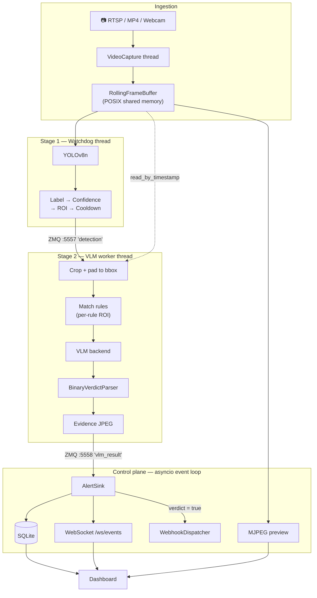

# Eye-Q — Implementation & Architecture

> How the system is built, why it is built that way, and how to verify it.
> For the original design brief see [PLAN.md](PLAN.md); this document describes
> what actually exists in the code.

---

## 1. What Eye-Q Is

A retrofit appliance for conventional IP cameras. You point it at an RTSP
stream and describe what you care about in plain English — *"Is a worker
missing a hard hat?"* — and it raises alerts. No model training, no cloud, no
per-use-case ML work.

The hard constraint is thermal: a Vision-Language Model cannot run on every
frame at 30 FPS on edge hardware. Eye-Q solves this with a **two-stage
cascade**.

| | Stage 1 — Watchdog | Stage 2 — VLM |
|---|---|---|
| Model | YOLOv8n (nano) | Moondream2 (1.86B) or a local server |
| Runs | Always, up to 30 FPS | Wake-on-event only |
| Cost | ~2–4 ms/frame | ~800 ms (GPU) – 8 s (CPU) |
| Job | Cheap filter: *is anything here?* | Expensive judgement: *does it violate the rule?* |

Stage 1 discards 99%+ of frames, so Stage 2's duty cycle drops from 100% to
well under 1%. That ratio is the entire product.

---

## 2. Architecture



### The two ZMQ channels

| Endpoint | Topic | Publisher | Subscriber |
|---|---|---|---|
| `tcp://127.0.0.1:5557` | `detection` | Stage 1 watchdog thread | Stage 2 worker thread |
| `tcp://127.0.0.1:5558` | `vlm_result` | Stage 2 worker thread | AlertSink (event loop) |

They are deliberately **separate endpoints**, not two topics on one socket.
ZMQ sockets are not thread-safe, and Stage 1 and Stage 2 live in different
threads — sharing one publisher between them is undefined behaviour. Each
publisher is now created inside the thread that sends on it.

### Threading model

| Thread | Blocks on | Never blocks on |
|---|---|---|
| `VideoCapture-*` | `cap.grab()` (I/O) | Buffer writes (sub-ms) |
| `YOLOWatchdog` | YOLO inference (~2–4 ms) | Buffer reads, ZMQ publish |
| `VLMWorker` | VLM inference (0.8–8 s) | Buffer reads (stale triggers dropped) |
| `VLMInfer` | One inference, bounded by `vlm_timeout_s` | — |
| uvicorn event loop | Nothing — fully async | — |

**Invariant: a slow VLM must never drop video frames.** Guaranteed by three
properties — the ring buffer never blocks on write (it overwrites), the VLM
runs in its own thread, and ZMQ sends are non-blocking.

The MJPEG encoder respects the same rule from the other direction: `cv2.imencode`
is CPU-bound, so it runs under `asyncio.to_thread`. Encoding inline would stall
the event loop and take the REST API and WebSocket down with it.

---

## 3. End-to-End Flow

What happens when a person walks into frame:

1. **Capture** — `VideoCapture` grabs a frame and writes it into the ring
   buffer with a `time.monotonic()` timestamp. Frames above `target_fps` are
   grabbed but not decoded.
2. **Detect** — `YOLOWatchdog` reads the newest frame, runs YOLOv8n, and
   applies four filters in order: label whitelist → confidence → ROI polygon →
   per-label cooldown.
3. **Trigger** — a surviving detection is published as a `DetectionEvent` on
   `:5557`. Detections killed by cooldown are still recorded for the live
   overlay, so boxes do not blink.
4. **Fetch** — `VLMWorker` wakes, discards the trigger if older than
   `vlm_staleness_s`, then pulls the *exact* frame back out of the buffer by
   timestamp (falling back to slot index if the buffer wrapped).
5. **Crop** — the frame is cropped to the bounding box plus 15% padding.
   Padding matters: the model needs context to reason about relationships like
   *"blocking the exit."*
6. **Match** — rules for that label are selected, and each rule's own ROI is
   tested against the detection.
7. **Judge** — each matching rule's prompt is sent to the VLM under a hard
   timeout. `" Answer with only Yes or No."` is appended, because
   `BinaryVerdictParser` is most reliable on its first-word strategy.
8. **Record** — an evidence JPEG is written, and a `VLMResult` goes out on
   `:5558`.
9. **Alert** — `AlertSink` persists the row, broadcasts it over the WebSocket,
   and fires the webhook for violations only.

### Latency budget (measured, Apple Silicon)

| Stage | Latency |
|---|---|
| Frame capture + buffer write | ~1 ms |
| YOLO inference (MPS) | ~2–4 ms |
| Filters (pure geometry) | <0.1 ms |
| ZMQ round trip | ~0.1 ms |
| Crop | ~0.5 ms |
| **VLM inference** | **~8,300 ms (Moondream2, CPU)** |
| Verdict parse + DB insert | ~1 ms |
| **Total trigger → alert** | **~8.3 s** |

The VLM dominates by three orders of magnitude — hence the cascade, and hence
`vlm_timeout_s` defaulting to 60s as a runaway guard rather than a latency
target.

---

## 4. Components

### `app/core/buffer.py` — `RollingFrameBuffer`

Fixed-size circular buffer in POSIX shared memory. Three segments:

| Segment | Contents |
|---|---|
| `eyeq_frames_{id}` | `uint8[capacity, H, W, C]` — pixel data |
| `eyeq_ts_{id}` | `float64[capacity]` — timestamps |
| `eyeq_meta_{id}` | `int64[2]` — `[write_head, frame_count]` |

Writers take a lock; readers are lock-free with stale-OK semantics (a torn
frame produces a low-confidence YOLO detection, which the filters drop).
Reads return copies, so a caller can never hold a pointer into memory that is
about to be overwritten.

The counters live in shared memory rather than `multiprocessing.Value` because
each `Value`/`Lock` carries a POSIX semaphore that `unlink()` cannot release —
they leaked on every shutdown. Writers are threads in one process, so
`threading.Lock` is the correct level of exclusion.

**Sizing.** Defaults are 1280×720 × 150 frames ≈ **405 MB** (5s of history).
The PLAN.md default of 1080p × 300 would be 1.77 GB, which is not viable on an
edge device.

### `app/core/capture.py` — `VideoCapture`

Daemon thread wrapping `cv2.VideoCapture`. Exponential backoff reconnection
(1s → 2s → 4s …, capped at 30s), interruptible so shutdown never waits out a
sleep.

Frame pacing state is held on the instance rather than per-connection: a video
file that ends and restarts would otherwise write a frame immediately on every
reconnect, blowing past `target_fps`. A connection that dies within
`_MIN_SESSION_S` is treated as an immediate EOF and paced, which stops a
finished video file from spinning the reconnect loop hundreds of times a second.

### `app/pipelines/detector.py` — `YOLOWatchdog`

Stage 1. Loads YOLO with automatic CPU fallback if the accelerator rejects it,
then filters detections through label → confidence → ROI → cooldown, counting
rejections at each stage for the status endpoint. `recent_detections()` feeds
the dashboard overlay.

### `app/pipelines/vlm_worker.py` — `VLMWorker`

Stage 2. Owns its ZMQ sockets, runs each inference through a single-worker
executor to bound latency, and writes one evidence JPEG per trigger shared
across the rules it fires.

The executor has exactly one worker on purpose: if an inference hangs, the next
submit blocks and times out quickly rather than fanning out runaway threads.
On timeout the worker calls `backend.request_stop()`, so a cooperative backend
releases that thread instead of leaving it pinned until the dead inference
finishes.

**Backlog coalescing.** Inference (~1–8s) is far slower than Stage 1 produces
triggers, so a queue builds. Draining it in arrival order means always working
on the *oldest* frame — exactly the one most likely to have aged past
`vlm_staleness_s` by the time it is dequeued, so the budget gets spent on work
that is then discarded. `_collect_batch()` instead drains everything pending
and keeps only the **newest trigger per label**, newest first: an older
detection of the same label describes a scene a fresher frame already
supersedes. Distinct labels all survive, since they may match different rules.

Measured effect depends entirely on label diversity. With a focused rule
(watchdog narrowed to `person`), **70% of backlogged triggers collapsed** as
superseded. Against the unfiltered demo video — ~10 COCO labels arriving
evenly — it collapsed only 3%, because same-label repeats rarely land in one
drain batch. It helps real deployments, which watch one or two labels; it does
little when the watchdog is wide open.

A high stale count is **not** waste: staleness is checked before the frame
fetch and before inference, so discarding costs almost nothing. It is correct
load shedding. At 5.7s per inference the VLM serves ~10 triggers/min while
Stage 1 published ~74/min — the shortfall is arithmetic, not inefficiency.

### `app/pipelines/vlm_backends.py` — pluggable VLM

All three backends are **fully local** — Eye-Q has no cloud dependency in any
configuration. Select with `EYEQ_VLM_BACKEND`.

| Backend | When to use |
|---|---|
| `moondream` (default) | Simplest. In-process, no external service. Pinned to revision `2024-08-26`, whose API is `encode_image()` + `answer_question()` — hence `transformers<4.50`. |
| `transformers` | Any chat-templated vision-to-text model in-process via `AutoProcessor` + `AutoModelForVision2Seq` — Qwen2-VL-2B, SmolVLM, MiniCPM-V. Set `EYEQ_VLM_MODEL` to the HF id. |
| `openai_compat` | **Fastest on constrained edge hardware.** Points at Ollama / llama.cpp / vLLM on the same box. A quantized server typically beats HF Transformers on CPU by a wide margin and keeps multi-GB weights out of this process. |

#### Swapping the model

Any model, zero code change. Via a local server (recommended on edge):

```bash
ollama pull qwen2-vl:2b
EYEQ_VLM_BACKEND=openai_compat \
EYEQ_VLM_API_BASE=http://127.0.0.1:11434/v1 \
EYEQ_VLM_API_MODEL=qwen2-vl:2b \
uv run python main.py
```

Or in-process:

```bash
EYEQ_VLM_BACKEND=transformers \
EYEQ_VLM_MODEL=Qwen/Qwen2-VL-2B-Instruct \
uv run python main.py
```

Edge-viable options:

| Model | Params | Download | Notes |
|---|---|---|---|
| SmolVLM-Instruct | 2B | ~4.5 GB | Lightest; Idefics3 architecture |
| **Qwen2-VL-2B-Instruct** | 2B | ~4.4 GB | Best quality-per-watt at this size |
| Qwen2.5-VL-3B-Instruct | 3B | ~7 GB | Stronger; needs `transformers>=4.49` |
| Moondream2 | 1.86B | ~3.7 GB | Current default; VQA-focused |

The installed `transformers` is **4.49.0**, pinned `<4.50` for Moondream2's
`2024-08-26` revision. Models whose `model_type` shipped in 4.50+ (SmolVLM2,
among others) will not load until that pin is raised — which means retesting
Moondream.

Generation is greedy (`do_sample=False`) in the in-process backends: a binary
verdict must be reproducible, and sampling would make the same frame answer
differently between runs.

Whatever the model, `BinaryVerdictParser` handles the response, and Eye-Q
appends `" Answer with only Yes or No."` to every prompt — so a new model
needs no prompt engineering to slot in.

### `app/pipelines/vlm_judge.py` — `BinaryVerdictParser`

Free text → strict boolean. First-word check, then affirmative/negative keyword
scoring with negation handling, defaulting to `False` when ambiguous.

Biased toward false negatives on purpose: in security monitoring, false alarms
cause alert fatigue and operators stop trusting the system entirely.

### `app/services/alert_sink.py` — `AlertSink`

The bridge from Stage 2 back into the control plane, running as an asyncio task.
Per verdict it persists an `alerts` row, broadcasts it, and webhooks violations.

Two details that matter:

- It stores **clears as well as violations** — a history that only records
  positives cannot tell you the system was watching.
- It broadcasts the **stored DB row**, not the `VLMResult`. The dashboard
  renders live cards and paginated history through one code path that reads DB
  column names, so the shapes must match.
- A sentinel rule (`id=0`, disabled) owns verdicts whose rule was deleted mid-flight,
  since `alerts.rule_id` is a foreign key.

### `app/api/server.py` — control plane

The lifespan owns **every** component and starts them in dependency order
(DB → buffer → capture → Stage 1 → Stage 2 → sink), tearing down in reverse.
Single ownership is the point: splitting it between here and `main.py` is what
previously let startup silently sever rule delivery.

`sync_rules()` runs on startup and after every rule mutation:

- **Stage 1** gets the *coarsest* settings across all rules — label union,
  minimum confidence, minimum cooldown — so it never filters out something a
  rule still wants to see.
- **Stage 2** gets each rule's own prompt and ROI. Per-rule ROI is enforced
  here rather than in the watchdog because one watchdog cannot carry N distinct
  polygons, and point-in-polygon is free at trigger rates.

---

## 5. Configuration

Everything flows through `Settings` (`app/config/settings.py`), overridable by
`EYEQ_*` environment variables or a `.env` file.

| Variable | Default | Notes |
|---|---|---|
| `EYEQ_DEFAULT_SOURCE` | `0` | RTSP URI, file path, or webcam index |
| `EYEQ_FRAME_WIDTH` / `_HEIGHT` | `1280` / `720` | Buffer frame size |
| `EYEQ_BUFFER_CAPACITY` | `150` | ~405 MB at 720p; 5s of history |
| `EYEQ_TARGET_FPS` | `30` | Capture rate cap |
| `EYEQ_DEVICE` | `auto` | Stage 1: MPS → CUDA → CPU |
| `EYEQ_VLM_DEVICE` | `cpu` | Moondream2 crashes on MPS |
| `EYEQ_VLM_BACKEND` | `moondream` | or `transformers` / `openai_compat` |
| `EYEQ_VLM_MODEL` | `vikhyatk/moondream2` | HF id for `moondream` / `transformers` |
| `EYEQ_VLM_API_BASE` | `http://127.0.0.1:11434/v1` | Local server for `openai_compat` |
| `EYEQ_VLM_API_MODEL` | `moondream` | Model name requested from that server |
| `EYEQ_VLM_TIMEOUT_S` | `60.0` | Runaway guard, not a latency target |
| `EYEQ_VLM_MAX_TOKENS` | `24` | Worst-case cap; verdicts need ~2 tokens |
| `EYEQ_VLM_STALENESS_S` | `5.0` | Drop triggers older than this |
| `EYEQ_YOLO_CONFIDENCE` | `0.25` | Overridden by the minimum across rules |
| `EYEQ_DETECTION_COOLDOWN_S` | `5.0` | Per-label trigger throttle |
| `EYEQ_STREAM_FPS` | `12.0` | MJPEG preview rate |
| `EYEQ_WEBHOOK_URL` | `None` | Fire-and-forget, no retry |
| `EYEQ_ENABLE_PIPELINE` | `true` | `--api-only` sets this false |
| `EYEQ_ENABLE_VLM` | `true` | `--no-vlm` sets this false |

CLI flags in `main.py` are translated into these variables **before** the first
`get_settings()` call, since settings are `lru_cache`d.

---

## 6. API

| Method | Path | Purpose |
|---|---|---|
| `GET` | `/` | Dashboard |
| `GET` | `/api/stream/{camera_id}.mjpg` | Live MJPEG preview with overlays |
| `GET`/`POST` | `/api/rules` | List / create rules |
| `GET`/`PUT`/`DELETE` | `/api/rules/{id}` | Read / update / delete |
| `GET` | `/api/alerts?limit=&offset=&rule_id=` | Paginated history |
| `GET` | `/api/alerts/{id}` | Single alert |
| `GET`/`POST` | `/api/cameras` | Camera registry |
| `GET` | `/api/status` | Health, FPS, buffer, VLM stats |
| `WS` | `/ws/events` | Live `alert` / `status` events |
| `GET` | `/snapshots/{file}` | Alert evidence JPEGs |

Rule mutations trigger `sync_rules()` synchronously, so a rule takes effect on
the next frame.

---

## 7. What Changed From the Committed Baseline

Phases 0–4 of PLAN.md were committed and the individual components were sound,
but the cascade was broken at its final hop. Fixed here:

| # | Defect | Fix |
|---|---|---|
| 1 | **`vlm_result` had no consumer.** Verdicts were published into the void — `create_alert()` was never called, the alerts table stayed empty forever, and no webhook code existed. The product did not work end to end. | Added `AlertSink` + `WebhookDispatcher` + `AsyncEventSubscriber`. |
| 2 | **The lifespan clobbered `main.py`'s components**, resetting them to `None` after they were wired. Rules never reached the VLM, so every trigger used the generic default prompt — the plain-English rules were ignored entirely. | Lifespan is now the single owner; `main.py` is a thin CLI. |
| 3 | **One ZMQ PUB socket shared across two threads** — undefined behaviour. | Separate endpoints; each publisher created in its own thread. |
| 4 | **Per-rule config never reached Stage 1.** `target_labels` was `None`, so every COCO class woke the VLM. | `sync_rules()` pushes labels/confidence/cooldown to Stage 1 and prompts/ROI to Stage 2. |
| 5 | ~15 dead `pass` route stubs on a router that was never registered. | `routes.py` reduced to shared models + `ConnectionManager`. |
| 6 | No live video; `frame_snapshot` always NULL. | MJPEG endpoint + evidence JPEGs + dashboard thumbnails. |
| 7 | `vlm_timeout_s` and `webhook_url` defined but never used. | Both enforced. Timeout default raised 10s → 60s after measuring ~8.3s CPU inference. |
| 8 | Both `opencv-python` and `opencv-python-headless` installed. | Kept `opencv-python` (`demo.py` needs `imshow`). |
| 9 | Missing `test_capture.py` / `test_api.py`. | Added, plus `test_alert_sink.py`. |

Two further defects surfaced during verification and were fixed:

- **Reconnect spin.** A video file that ends reset the frame-pacing clock, so
  the capture loop reopened the source ~550×/second. Directly affected the
  `demovideo.mp4` demo.
- **Leaked semaphores.** `multiprocessing.Value`/`Lock` in the buffer leaked
  3 POSIX semaphores on every shutdown.

---

## 8. Verification

```bash
uv run ruff check .              # clean
uv run pytest -m "not slow"      # fast suite, no model downloads
uv run pytest                    # includes real YOLO + VLM
```

End-to-end against the bundled demo video:

```bash
EYEQ_DEFAULT_SOURCE=demovideo.mp4 uv run python main.py
```

1. Open `http://localhost:8000` — the MJPEG panel shows live YOLO boxes.
2. Create a rule: prompt *"Is there a person in this image?"*, label `person`.
3. Logs show the chain: `Detection published: person` → `VLM query: [person]`
   → `VLM result: 🔴 YES`.
4. An alert card appears **without reloading** (WebSocket), with a snapshot.
5. `sqlite3 data/eyeq.db "SELECT count(*) FROM alerts;"` is non-zero.
6. The logged prompt is the *rule's* prompt, not the default.
7. Ctrl-C shuts down cleanly with no leaked-resource warnings.

Stage-1-only visual runner (no VLM load):

```bash
uv run python demo.py --source demovideo.mp4 --labels person
```

---

## 9. Known Limitations

- **Single camera.** The schema, API, and buffer IDs are multi-camera-shaped,
  but one capture/watchdog pair runs today. Multi-camera needs a buffer per
  stream (~405 MB each at 720p).
- **Moondream2 gets no benefit from MPS.** It runs there without crashing
  (contrary to a stale comment in the original `settings.py`), but measured
  6.1s/query on MPS vs 5.6s on CPU, with a ~10s longer load — so `vlm_device`
  defaults to CPU and MPS is left to Stage 1. Real edge throughput comes from
  `openai_compat` against a local quantized server, not from the accelerator.
- **Only the Moondream path is exercised end to end here.** The `transformers`
  and `openai_compat` backends are unit-tested for construction and protocol
  conformance, but were not run against live weights — validate your chosen
  model on the target board before deploying.
- **Aborting a timed-out inference is backend-dependent.** The
  `transformers` backend halts generation cooperatively via a
  `StoppingCriteria` watching a stop event. `moondream` cannot — its wrapper
  drives `generate()` internally and takes no stopping hook — so a timed-out
  Moondream inference still runs to completion and is merely ignored.
- **Watchdog ROI is global.** Per-rule ROI is enforced in Stage 2, so a
  detection outside every rule's ROI still costs a YOLO trigger and a buffer
  fetch (but no VLM call).
