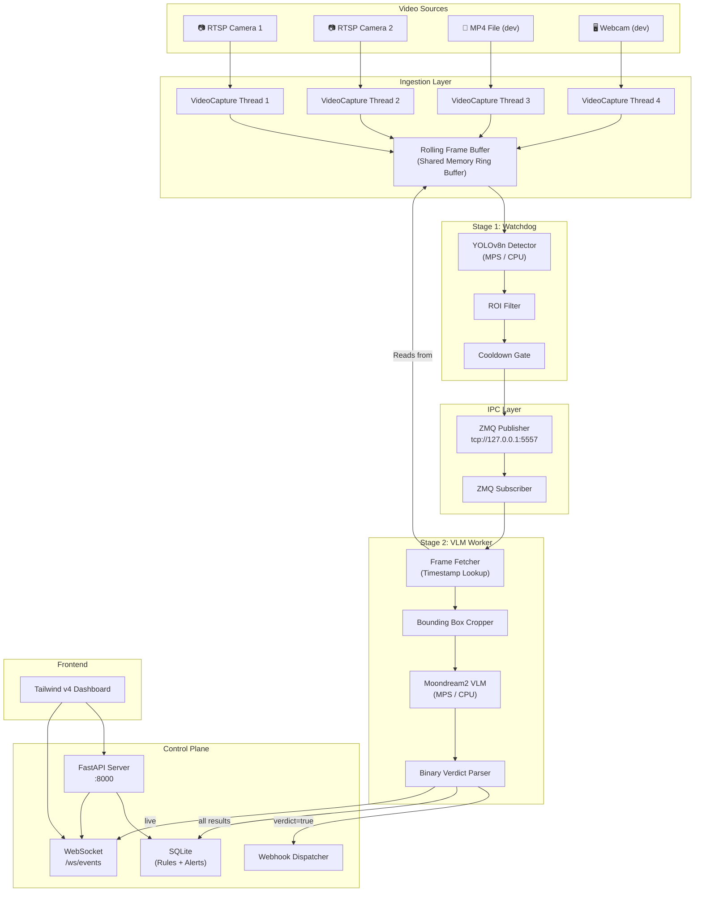
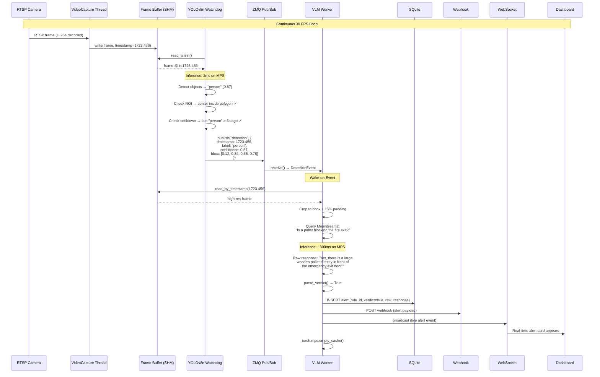
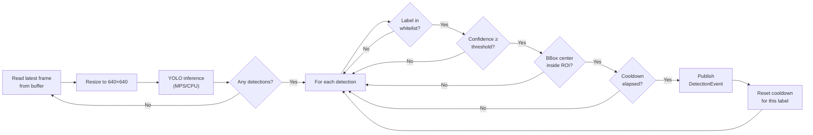
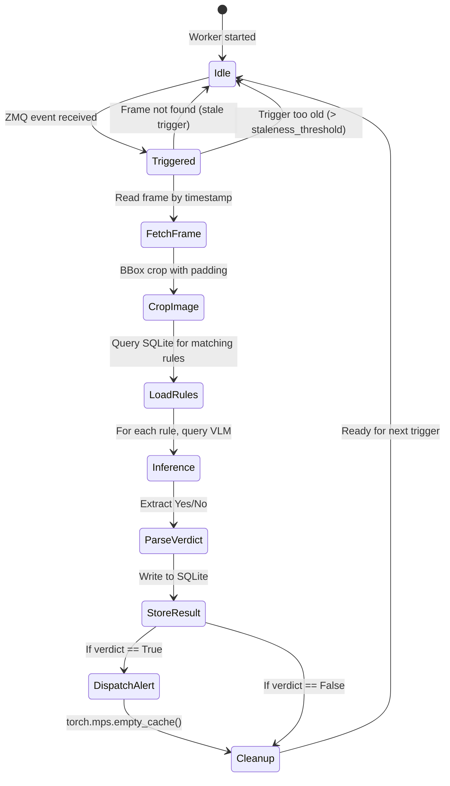
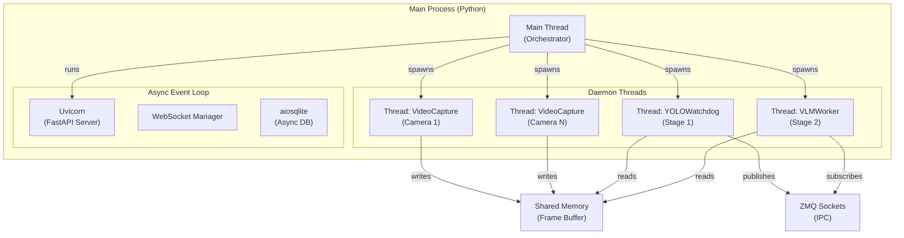

# Eye-Q — Detailed Architecture Document

> **Open-Vocabulary VLM Retrofit Appliance**
> Intercept RTSP streams from conventional IP cameras. Define security alerts in plain English. No model training required.

---

## Table of Contents

1. [System Overview](#1-system-overview)
2. [High-Level Architecture](#2-high-level-architecture)
3. [Data Flow — End to End](#3-data-flow--end-to-end)
4. [Component Deep Dives](#4-component-deep-dives)
   - 4.1 [Video Ingestion & Capture](#41-video-ingestion--capture)
   - 4.2 [Rolling Frame Buffer (Shared Memory)](#42-rolling-frame-buffer-shared-memory)
   - 4.3 [ZeroMQ IPC Layer](#43-zeromq-ipc-layer)
   - 4.4 [Stage 1 — YOLO Watchdog](#44-stage-1--yolo-watchdog)
   - 4.5 [Stage 2 — VLM Inference Worker](#45-stage-2--vlm-inference-worker)
   - 4.6 [Control Plane (FastAPI + SQLite)](#46-control-plane-fastapi--sqlite)
   - 4.7 [Frontend Dashboard (Tailwind v4)](#47-frontend-dashboard-tailwind-v4)
5. [Concurrency & Threading Model](#5-concurrency--threading-model)
6. [Device Acceleration Strategy](#6-device-acceleration-strategy)
7. [Configuration System](#7-configuration-system)
8. [Error Handling & Resilience](#8-error-handling--resilience)
9. [Directory Structure](#9-directory-structure)
10. [Dependency Manifest](#10-dependency-manifest)
11. [Phased Execution Roadmap](#11-phased-execution-roadmap)

---

## 1. System Overview

Eye-Q is a **two-stage cascade** inference appliance designed for edge deployment. It replaces expensive, per-use-case model training with a composable pipeline:

| Property | Value |
|---|---|
| **Input** | RTSP streams, MP4 files, USB/webcam (for dev) |
| **Stage 1** | Lightweight object detector (YOLOv8n) — always running, 30 FPS |
| **Stage 2** | Vision-Language Model (Moondream2, 1.86B params) — wake-on-event |
| **Output** | Binary verdict (Yes/No) + webhook dispatch |
| **User Interface** | Plain-English rule editor via web dashboard |
| **Target Hardware** | Apple Silicon (MPS) for dev, edge NPUs for production |
| **Package Manager** | `uv` (strict) |

### Why Two Stages?

Running a VLM on every frame at 30 FPS is thermally and computationally impossible on edge hardware. The cascade architecture solves this:

- **Stage 1 (YOLO):** Cheap. ~2ms/frame on MPS. Filters 99%+ of frames as "nothing interesting."
- **Stage 2 (VLM):** Expensive. ~500ms–2s/inference. Only invoked when Stage 1 fires a trigger — typically a few times per minute, not 30 times per second.

This reduces VLM GPU utilization from **100%** to **< 1%** in typical surveillance scenarios.

---

## 2. High-Level Architecture



---

## 3. Data Flow — End to End

Here is exactly what happens when a pallet blocks a fire exit, step by step:



### Timing Budget (per trigger cycle)

| Stage | Latency | Notes |
|---|---|---|
| Frame capture | ~1ms | OpenCV decode |
| Buffer write | ~0.1ms | memcpy into shared memory |
| YOLO inference | ~2-4ms | YOLOv8n on MPS (640×640) |
| ROI + cooldown check | ~0.01ms | Pure Python geometry |
| ZMQ publish | ~0.05ms | tcp localhost, ~100 byte JSON |
| ZMQ receive | ~0.1ms | Poller with timeout |
| Buffer timestamp lookup | ~0.01ms | Linear scan over ≤300 entries |
| Frame crop | ~0.5ms | NumPy slice + resize |
| VLM inference | ~500-2000ms | Moondream2 on MPS |
| Verdict parse | ~0.01ms | Regex/keyword match |
| DB insert | ~1ms | SQLite async write |
| Webhook dispatch | ~50-500ms | External HTTP, async fire-and-forget |
| **Total trigger→alert** | **~550-2500ms** | Dominated by VLM inference |

---

## 4. Component Deep Dives

### 4.1 Video Ingestion & Capture

**File:** `app/core/capture.py`
**Class:** `VideoCapture`

#### Responsibilities
- Open and maintain a video stream (RTSP, file, or device)
- Decode frames as fast as the source allows
- Write each frame + timestamp into the rolling buffer
- Handle disconnections with exponential backoff

#### Design Details

```python
class VideoCapture:
    """Non-blocking video capture running in a dedicated daemon thread.
    
    Continuously grabs frames from the source and writes them into
    the shared-memory ring buffer. Designed to never block the main
    thread or any downstream consumer — if the buffer is full, the
    oldest frame is silently overwritten.
    """
    
    def __init__(
        self,
        source: str | int,          # RTSP URI, file path, or device index
        buffer: RollingFrameBuffer,  # Shared memory ring buffer
        camera_id: str,              # Unique identifier for this stream
        target_fps: int = 30,        # Frame rate cap
        reconnect_max_retries: int = 5,
        reconnect_base_delay: float = 1.0,  # Seconds, doubles each retry
    ): ...
```

#### Reconnection Strategy

```mermaid
statechart
    [*] --> Connecting
    Connecting --> Capturing : cap.isOpened()
    Connecting --> WaitRetry : cap.open() fails
    WaitRetry --> Connecting : sleep(delay); delay *= 2
    WaitRetry --> Failed : retries exhausted
    Capturing --> Capturing : frame grabbed OK
    Capturing --> Connecting : frame grab failed (stream lost)
    Failed --> [*]
```

**Reconnection behavior:**
1. On stream loss, log a warning and attempt to reopen
2. Exponential backoff: 1s → 2s → 4s → 8s → 16s
3. After 5 consecutive failures, emit a critical error event and stop
4. On successful reconnect, reset retry counter

#### Frame Rate Control
- Calculate `frame_interval = 1.0 / target_fps`
- After each `cap.read()`, check elapsed time
- If source is faster than target, use `cap.grab()` (decode skip) to stay synchronized
- If source is slower (e.g., RTSP at 15 FPS), process every frame

#### Thread Safety
- Runs in `threading.Thread(daemon=True)` — dies with main process
- Shutdown coordinated via `threading.Event`
- Buffer writes are synchronized by the buffer's own lock

---

### 4.2 Rolling Frame Buffer (Shared Memory)

**File:** `app/core/buffer.py`
**Class:** `RollingFrameBuffer`

This is the **critical shared data structure** at the center of the system. It enables zero-copy frame sharing between the capture thread, the YOLO watchdog, and the VLM worker.

#### Memory Layout

```
┌─────────────────────────────────────────────────────────────────┐
│                    SHARED MEMORY BLOCK 1                        │
│                     "eyeq_frames_{id}"                          │
│                                                                 │
│  ┌──────────┬──────────┬──────────┬─────┬──────────┐           │
│  │ Frame 0  │ Frame 1  │ Frame 2  │ ... │Frame N-1 │           │
│  │ H×W×C    │ H×W×C    │ H×W×C    │     │ H×W×C    │           │
│  │ uint8    │ uint8    │ uint8    │     │ uint8    │           │
│  └──────────┴──────────┴──────────┴─────┴──────────┘           │
│                                                                 │
│  Total Size = N × H × W × C bytes                              │
│  Example: 300 × 1080 × 1920 × 3 = 1,866,240,000 bytes (≈1.7GB)│
└─────────────────────────────────────────────────────────────────┘

┌─────────────────────────────────────────────────────────────────┐
│                    SHARED MEMORY BLOCK 2                        │
│                    "eyeq_timestamps_{id}"                       │
│                                                                 │
│  ┌──────────┬──────────┬──────────┬─────┬──────────┐           │
│  │  ts[0]   │  ts[1]   │  ts[2]   │ ... │ ts[N-1]  │           │
│  │ float64  │ float64  │ float64  │     │ float64  │           │
│  │  8 bytes │  8 bytes │  8 bytes │     │  8 bytes │           │
│  └──────────┴──────────┴──────────┴─────┴──────────┘           │
│                                                                 │
│  Total Size = N × 8 bytes                                       │
│  Example: 300 × 8 = 2,400 bytes                                │
└─────────────────────────────────────────────────────────────────┘

┌──────────────────────────┐    ┌──────────────────────────┐
│  multiprocessing.Value   │    │  multiprocessing.Value   │
│  "write_head" (int32)    │    │  "frame_count" (int64)   │
│  Current write position  │    │  Total frames written    │
└──────────────────────────┘    └──────────────────────────┘
```

#### Circular Write Semantics

```
Time →

write_head = 0:  [F0][ ][ ][ ][ ]     ← First frame written to slot 0
write_head = 1:  [F0][F1][ ][ ][ ]
write_head = 2:  [F0][F1][F2][ ][ ]
write_head = 3:  [F0][F1][F2][F3][ ]
write_head = 4:  [F0][F1][F2][F3][F4]
write_head = 0:  [F5][F1][F2][F3][F4]  ← F0 overwritten (oldest)
write_head = 1:  [F5][F6][F2][F3][F4]  ← F1 overwritten
...
```

The write head advances modulo `capacity`. **No allocation or deallocation ever occurs** after initialization — the buffer is a fixed-size region that wraps around.

#### API Surface

```python
class RollingFrameBuffer:
    """Lock-light circular buffer backed by POSIX shared memory.
    
    Architecture:
    - Two shared memory segments: one for frame pixel data (uint8),
      one for timestamps (float64).
    - A shared atomic integer tracks the write head position.
    - Writers acquire a lock; readers are lock-free (stale-OK semantics).
    
    This means a reader may occasionally read a frame that is in the
    process of being overwritten. For our use case (YOLO reads latest,
    VLM reads by timestamp), this is acceptable — a torn frame simply
    produces a low-confidence or garbage YOLO detection, which is
    harmless. The VLM worker validates frame integrity after fetch.
    """
    
    def __init__(
        self,
        capacity: int = 300,        # ~10 seconds at 30 FPS
        frame_height: int = 1080,
        frame_width: int = 1920,
        frame_channels: int = 3,
        buffer_id: str = "default",  # For multi-camera disambiguation
    ): ...
    
    def write(self, frame: np.ndarray, timestamp: float) -> int:
        """Write a frame into the next slot. Returns the slot index."""
        ...
    
    def read_latest(self) -> tuple[np.ndarray, float, int]:
        """Return (frame_copy, timestamp, slot_index) of the most recent frame."""
        ...
    
    def read_by_timestamp(
        self, target_ts: float, tolerance_ms: float = 100.0
    ) -> tuple[np.ndarray, float, int] | None:
        """Find the frame closest to target_ts within tolerance.
        Returns None if no frame is within tolerance window.
        Linear scan over timestamp array — O(capacity) but capacity ≤ 300.
        """
        ...
    
    def read_at_index(self, index: int) -> tuple[np.ndarray, float]:
        """Direct slot access. Returns (frame_copy, timestamp)."""
        ...
    
    @property
    def stats(self) -> BufferStats:
        """Current buffer statistics (frames written, occupancy, etc.)."""
        ...
    
    def close(self) -> None:
        """Detach from shared memory (call from every process)."""
        ...
    
    def unlink(self) -> None:
        """Destroy the shared memory segment (call from owner process only)."""
        ...
```

#### Key Design Decisions

| Decision | Rationale |
|---|---|
| **Two separate SHM blocks** (frames + timestamps) | Avoids complex struct packing. Timestamps are 8 bytes vs frames at ~6MB each — interleaving would waste cache lines. |
| **Lock-free reads** | Stage 1 reads at 30 FPS. Lock contention would kill throughput. A torn frame is harmless (YOLO produces low confidence → dropped). |
| **Writer-side lock only** | Prevents two cameras from writing to the same slot simultaneously in multi-camera mode. |
| **`np.ndarray` views** | Zero-copy access. The NumPy array IS the shared memory — no serialization, no pickling. |
| **300-frame default capacity** | At 30 FPS = 10 seconds of history. Enough for VLM to look up a frame from 2-3 seconds ago. Memory cost: ~1.7GB at 1080p. |
| **Copy on read** | `read_latest()` returns `frame.copy()`, not a view. This prevents the reader from holding a reference to memory that might be overwritten. The copy cost (~6ms for 1080p) is acceptable given VLM latency. |

#### Memory Sizing Table

| Resolution | Frame Size | 300 Frames | 150 Frames | 60 Frames |
|---|---|---|---|---|
| 640×480 | 0.9 MB | 270 MB | 135 MB | 54 MB |
| 1280×720 | 2.7 MB | 810 MB | 405 MB | 162 MB |
| 1920×1080 | 5.9 MB | 1.77 GB | 885 MB | 354 MB |
| 3840×2160 | 23.7 MB | 7.1 GB | 3.55 GB | 1.42 GB |

> [!WARNING]
> For 4K streams, reduce buffer capacity to 60–90 frames or downscale during ingestion. The default 300-frame buffer at 4K would consume 7GB — unacceptable for edge devices.

---

### 4.3 ZeroMQ IPC Layer

**File:** `app/core/ipc.py`
**Classes:** `EventPublisher`, `EventSubscriber`

#### Transport Selection

| Transport | Latency | Use Case |
|---|---|---|
| `inproc://` | ~1μs | Same process, different threads — requires shared `zmq.Context` |
| `ipc://` | ~10μs | Different processes, same machine (UNIX domain sockets) |
| `tcp://` | ~30μs | Most portable; works in-process, cross-process, and cross-machine |

**We use `tcp://127.0.0.1:5557`** for maximum flexibility. The 30μs overhead is negligible against VLM inference times of 500ms+. This also allows future deployment where Stage 2 runs on a separate machine.

#### Message Protocol

All messages use ZMQ **multipart frames**:

```
Frame 0 (topic):   b"detection"           ← UTF-8 encoded topic string
Frame 1 (payload): b'{"timestamp": ...}'   ← JSON-encoded event payload
```

#### Topic Hierarchy

| Topic | Publisher | Subscriber | Description |
|---|---|---|---|
| `detection` | YOLO Watchdog | VLM Worker | Stage 1 trigger event |
| `vlm_result` | VLM Worker | Control Plane | Stage 2 verdict |
| `alert` | Control Plane | Dashboard (via WS) | Confirmed violation |
| `status` | All components | Dashboard | Health/metrics heartbeat |

#### Publisher Implementation

```python
class EventPublisher:
    """ZeroMQ PUB socket wrapper with topic-based multipart messaging.
    
    Usage:
        with EventPublisher("tcp://127.0.0.1:5557") as pub:
            pub.publish("detection", {"timestamp": 1723.456, ...})
    """
    
    def __init__(self, endpoint: str = "tcp://127.0.0.1:5557"):
        self._context = zmq.Context.instance()  # Shared singleton
        self._socket = self._context.socket(zmq.PUB)
        self._socket.setsockopt(zmq.SNDHWM, 1000)     # High-water mark
        self._socket.setsockopt(zmq.LINGER, 0)         # Don't block on close
        self._socket.bind(endpoint)
    
    def publish(self, topic: str, payload: dict) -> None:
        """Non-blocking multipart send. Drops message if HWM reached."""
        self._socket.send_multipart(
            [topic.encode("utf-8"), json.dumps(payload).encode("utf-8")],
            flags=zmq.NOBLOCK,
        )
```

#### Subscriber Implementation

```python
class EventSubscriber:
    """ZeroMQ SUB socket wrapper with non-blocking receive via Poller.
    
    Usage:
        with EventSubscriber("tcp://127.0.0.1:5557", topic="detection") as sub:
            event = sub.receive(timeout_ms=1000)
            if event:
                topic, payload = event
    """
    
    def __init__(self, endpoint: str, topic: str = ""):
        self._context = zmq.Context.instance()
        self._socket = self._context.socket(zmq.SUB)
        self._socket.setsockopt(zmq.RCVHWM, 1000)
        self._socket.setsockopt_string(zmq.SUBSCRIBE, topic)
        self._socket.connect(endpoint)
        self._poller = zmq.Poller()
        self._poller.register(self._socket, zmq.POLLIN)
    
    def receive(self, timeout_ms: int = 1000) -> tuple[str, dict] | None:
        """Non-blocking receive with timeout. Returns None if no message."""
        events = dict(self._poller.poll(timeout_ms))
        if self._socket in events:
            topic_bytes, payload_bytes = self._socket.recv_multipart()
            return (
                topic_bytes.decode("utf-8"),
                json.loads(payload_bytes.decode("utf-8")),
            )
        return None
```

#### Event Schemas

**File:** `app/schemas/events.py`

```python
from pydantic import BaseModel, Field
from typing import Optional

class BoundingBox(BaseModel):
    """Normalized bounding box coordinates (0.0 to 1.0)."""
    x1: float = Field(..., ge=0.0, le=1.0, description="Left edge")
    y1: float = Field(..., ge=0.0, le=1.0, description="Top edge")
    x2: float = Field(..., ge=0.0, le=1.0, description="Right edge")
    y2: float = Field(..., ge=0.0, le=1.0, description="Bottom edge")

class DetectionEvent(BaseModel):
    """Published by Stage 1 when a relevant object is detected."""
    timestamp: float          # time.monotonic() of the captured frame
    camera_id: str            # Which camera source
    label: str                # COCO class label (e.g., "person")
    confidence: float         # Detection confidence [0, 1]
    bbox: BoundingBox         # Normalized bounding box
    frame_index: int          # Slot index in the ring buffer

class VLMQuery(BaseModel):
    """Internal model binding a detection to a user-defined rule."""
    detection: DetectionEvent
    rule_id: int
    prompt: str               # User's plain-English question

class VLMResult(BaseModel):
    """Published by Stage 2 after VLM inference."""
    query: VLMQuery
    verdict: bool             # True = violation confirmed
    raw_response: str         # Full VLM text output
    inference_time_ms: float  # Wall-clock inference time
    model_name: str           # Which VLM was used
```

---

### 4.4 Stage 1 — YOLO Watchdog

**File:** `app/pipelines/detector.py`
**Class:** `YOLOWatchdog`

#### Responsibilities
1. Read the latest frame from the ring buffer at up to 30 FPS
2. Downscale to 640×640 and run YOLOv8n inference
3. Filter detections by: confidence threshold, label whitelist, ROI polygon
4. Apply per-label cooldown to prevent trigger flooding
5. Publish `DetectionEvent` to ZMQ for qualifying detections

#### Detection Pipeline (per frame)



#### ROI (Region of Interest)

**File:** `app/core/roi.py`

```python
@dataclass
class RegionOfInterest:
    """A polygon defining the area of interest within a camera's field of view.
    
    Coordinates are normalized [0.0, 1.0] relative to frame dimensions.
    Default is the full frame: [(0,0), (1,0), (1,1), (0,1)].
    """
    vertices: list[tuple[float, float]]
    
    def contains_point(self, x: float, y: float) -> bool:
        """Ray-casting algorithm for point-in-polygon test."""
        ...
    
    def contains_bbox_center(self, bbox: BoundingBox) -> bool:
        """Check if the center of a bounding box falls within the ROI."""
        cx = (bbox.x1 + bbox.x2) / 2
        cy = (bbox.y1 + bbox.y2) / 2
        return self.contains_point(cx, cy)
    
    @classmethod
    def full_frame(cls) -> "RegionOfInterest":
        """Factory for a ROI covering the entire frame."""
        return cls(vertices=[(0, 0), (1, 0), (1, 1), (0, 1)])
```

#### Cooldown Gate

Prevents the same label from triggering the VLM multiple times in rapid succession:

```python
class CooldownGate:
    """Per-label cooldown to prevent trigger flooding.
    
    Example: If cooldown_seconds=5.0, after detecting "person",
    no further "person" triggers are published for 5 seconds —
    even if YOLO keeps detecting the person in every frame.
    """
    
    def __init__(self, cooldown_seconds: float = 5.0):
        self._last_trigger: dict[str, float] = {}
        self._cooldown = cooldown_seconds
    
    def should_trigger(self, label: str) -> bool:
        now = time.monotonic()
        last = self._last_trigger.get(label, 0.0)
        if now - last >= self._cooldown:
            self._last_trigger[label] = now
            return True
        return False
```

#### YOLO Configuration

| Parameter | Default | Notes |
|---|---|---|
| `model` | `yolov8n.pt` | Nano model. Can swap to `yolov8s.pt` for accuracy or `yolo11n.pt` for newer arch |
| `device` | `mps` (fallback: `cpu`) | Auto-detected at startup |
| `imgsz` | 640 | Standard YOLO input size |
| `conf` | 0.25 | Minimum confidence threshold |
| `classes` | `None` (all) | Filter to specific COCO class IDs |
| `stream` | `True` | Generator mode for memory efficiency |
| `verbose` | `False` | Suppress per-frame logs |

---

### 4.5 Stage 2 — VLM Inference Worker

**File:** `app/pipelines/vlm_worker.py`
**Class:** `VLMWorker`

#### Responsibilities
1. Listen to ZMQ `detection` topic
2. On trigger: fetch the exact frame from buffer by timestamp
3. Crop the frame to the bounding box (with configurable padding)
4. Load the active rules from SQLite that match the detection label
5. Query the VLM with each rule's prompt
6. Parse the response into a binary verdict
7. Store results and dispatch alerts

#### VLM Lifecycle



#### Frame Cropping

```python
def crop_detection(
    frame: np.ndarray,
    bbox: BoundingBox,
    padding_ratio: float = 0.15,
) -> np.ndarray:
    """Crop the frame to the bounding box with percentage-based padding.
    
    Padding adds context around the detection, which significantly
    improves VLM comprehension (the model needs spatial context to
    understand relationships like "blocking the exit").
    
    Args:
        frame: Full-resolution frame (H, W, C)
        bbox: Normalized bounding box
        padding_ratio: Extra padding as fraction of bbox dimensions
    
    Returns:
        Cropped region as a new numpy array
    """
    h, w = frame.shape[:2]
    
    # Denormalize
    x1, y1 = int(bbox.x1 * w), int(bbox.y1 * h)
    x2, y2 = int(bbox.x2 * w), int(bbox.y2 * h)
    
    # Add padding
    pad_w = int((x2 - x1) * padding_ratio)
    pad_h = int((y2 - y1) * padding_ratio)
    
    # Clamp to frame bounds
    x1 = max(0, x1 - pad_w)
    y1 = max(0, y1 - pad_h)
    x2 = min(w, x2 + pad_w)
    y2 = min(h, y2 + pad_h)
    
    return frame[y1:y2, x1:x2].copy()
```

#### VLM Model Integration (Moondream2)

```python
class MoondreamVLM:
    """Wrapper around vikhyatk/moondream2 for visual question answering.
    
    Model size: ~1.86B parameters
    Memory footprint: ~3.7 GB (fp16)
    Inference time: ~500ms-2s on Apple MPS
    
    The model exposes a simple .query(image, question) API that
    returns a natural language answer. We parse this into a binary
    verdict using the BinaryVerdictParser.
    """
    
    def __init__(self, device: str = "mps", revision: str = "2025-06-21"):
        self._model = AutoModelForCausalLM.from_pretrained(
            "vikhyatk/moondream2",
            trust_remote_code=True,
            revision=revision,
            device_map={"": device},
        )
        self._tokenizer = AutoTokenizer.from_pretrained(
            "vikhyatk/moondream2", revision=revision
        )
        self._device = device
    
    def query(self, image: Image.Image, question: str) -> str:
        """Ask a yes/no question about the image. Returns raw text."""
        result = self._model.query(image, question)
        return result["answer"]
    
    def cleanup(self) -> None:
        """Release GPU memory after inference."""
        if self._device == "mps":
            torch.mps.empty_cache()
        elif self._device == "cuda":
            torch.cuda.empty_cache()
```

#### Binary Verdict Parser

**File:** `app/pipelines/vlm_judge.py`

```python
class BinaryVerdictParser:
    """Parses VLM free-text responses into a strict boolean verdict.
    
    Strategy (in order of precedence):
    1. Check if response starts with "Yes" or "No" (case-insensitive)
    2. Count affirmative vs. negative keywords
    3. If ambiguous, default to False (no alert) to minimize false positives
    
    Affirmative keywords: yes, correct, true, confirmed, affirmative,
                          indeed, certainly, blocking, violating, present
    Negative keywords:    no, incorrect, false, negative, not, neither,
                          absent, clear, empty, unblocked
    """
    
    AFFIRMATIVE = {"yes", "correct", "true", "confirmed", "affirmative",
                   "indeed", "certainly", "blocking", "violating", "present"}
    NEGATIVE = {"no", "incorrect", "false", "negative", "absent",
                "clear", "empty", "unblocked"}
    
    @classmethod
    def parse(cls, raw_response: str) -> bool:
        """Parse raw VLM response into True (violation) or False (clear)."""
        text = raw_response.strip().lower()
        
        # Strategy 1: Check first word
        first_word = text.split()[0].rstrip(".,!:;") if text else ""
        if first_word in ("yes", "yeah", "yep"):
            return True
        if first_word in ("no", "nope", "nah"):
            return False
        
        # Strategy 2: Keyword scoring
        words = set(text.split())
        affirm_score = len(words & cls.AFFIRMATIVE)
        negate_score = len(words & cls.NEGATIVE)
        
        if affirm_score > negate_score:
            return True
        
        # Default: no alert (minimize false positives)
        return False
```

#### Staleness Protection

The VLM worker discards triggers that are too old:

```python
STALENESS_THRESHOLD_S = 5.0  # Discard triggers older than 5 seconds

def _is_stale(self, event: DetectionEvent) -> bool:
    """Check if a detection event is too old to process."""
    age = time.monotonic() - event.timestamp
    if age > self.STALENESS_THRESHOLD_S:
        logger.warning(
            f"Discarding stale trigger: {event.label} "
            f"from {age:.1f}s ago (threshold: {self.STALENESS_THRESHOLD_S}s)"
        )
        return True
    return False
```

This is critical for resilience: if the VLM is slow and a backlog forms, we don't waste time processing frames that are no longer relevant.

---

### 4.6 Control Plane (FastAPI + SQLite)

**File:** `app/api/server.py`, `app/api/routes.py`, `app/core/database.py`

#### SQLite Schema

```sql
-- Rules: User-defined alert conditions
CREATE TABLE IF NOT EXISTS rules (
    id          INTEGER PRIMARY KEY AUTOINCREMENT,
    camera_id   TEXT    NOT NULL,               -- Which camera this rule applies to
    name        TEXT    NOT NULL,               -- Human-readable rule name
    prompt      TEXT    NOT NULL,               -- Plain English question for the VLM
    target_labels TEXT  NOT NULL DEFAULT '[]',  -- JSON array: ["person", "car"]
    roi_json    TEXT    NOT NULL DEFAULT '[]',  -- JSON polygon: [[0,0],[1,0],[1,1],[0,1]]
    confidence  REAL    NOT NULL DEFAULT 0.25,  -- Min YOLO confidence to trigger
    cooldown_s  REAL    NOT NULL DEFAULT 5.0,   -- Seconds between re-triggers
    enabled     INTEGER NOT NULL DEFAULT 1,     -- 0 = paused, 1 = active
    created_at  TEXT    NOT NULL DEFAULT (datetime('now')),
    updated_at  TEXT    NOT NULL DEFAULT (datetime('now'))
);

-- Alerts: Historical log of VLM verdicts
CREATE TABLE IF NOT EXISTS alerts (
    id              INTEGER PRIMARY KEY AUTOINCREMENT,
    rule_id         INTEGER NOT NULL REFERENCES rules(id) ON DELETE CASCADE,
    camera_id       TEXT    NOT NULL,
    timestamp       REAL    NOT NULL,           -- time.monotonic() of source frame
    verdict         INTEGER NOT NULL,           -- 0 = clear, 1 = violation
    raw_response    TEXT    NOT NULL,           -- Full VLM text output
    inference_ms    REAL    NOT NULL,           -- VLM inference wall-clock time
    bbox_json       TEXT    NOT NULL,           -- JSON bbox: {"x1":..., "y1":..., ...}
    frame_snapshot  TEXT,                       -- Optional: path to saved JPEG
    created_at      TEXT    NOT NULL DEFAULT (datetime('now'))
);

-- Cameras: Registered video sources
CREATE TABLE IF NOT EXISTS cameras (
    id          TEXT PRIMARY KEY,               -- User-defined camera ID
    name        TEXT NOT NULL,                  -- Human-readable name
    source      TEXT NOT NULL,                  -- RTSP URI, file path, or device index
    resolution  TEXT NOT NULL DEFAULT '1920x1080',
    fps         INTEGER NOT NULL DEFAULT 30,
    enabled     INTEGER NOT NULL DEFAULT 1,
    created_at  TEXT NOT NULL DEFAULT (datetime('now'))
);

-- Indexes for common queries
CREATE INDEX IF NOT EXISTS idx_alerts_rule_id ON alerts(rule_id);
CREATE INDEX IF NOT EXISTS idx_alerts_created_at ON alerts(created_at DESC);
CREATE INDEX IF NOT EXISTS idx_rules_camera_id ON rules(camera_id);
```

#### REST API Endpoints

| Method | Path | Description | Request Body | Response |
|---|---|---|---|---|
| `GET` | `/api/rules` | List all rules | — | `Rule[]` |
| `POST` | `/api/rules` | Create a new rule | `RuleCreate` | `Rule` |
| `GET` | `/api/rules/{id}` | Get a single rule | — | `Rule` |
| `PUT` | `/api/rules/{id}` | Update a rule | `RuleUpdate` | `Rule` |
| `DELETE` | `/api/rules/{id}` | Delete a rule | — | `204` |
| `GET` | `/api/alerts` | List alerts (paginated) | `?limit=50&offset=0&rule_id=` | `Alert[]` |
| `GET` | `/api/alerts/{id}` | Get a single alert | — | `Alert` |
| `GET` | `/api/cameras` | List cameras | — | `Camera[]` |
| `POST` | `/api/cameras` | Register a camera | `CameraCreate` | `Camera` |
| `DELETE` | `/api/cameras/{id}` | Remove a camera | — | `204` |
| `GET` | `/api/status` | System health | — | `SystemStatus` |
| `WS` | `/ws/events` | Live event stream | — | SSE-style JSON frames |

#### WebSocket Event Stream

The dashboard receives real-time updates via a WebSocket at `/ws/events`. Events are JSON objects:

```json
{
    "type": "alert",
    "data": {
        "rule_id": 3,
        "rule_name": "Pallet blocking fire exit",
        "camera_id": "warehouse_cam_1",
        "verdict": true,
        "raw_response": "Yes, there is a large wooden pallet...",
        "inference_ms": 823.4,
        "timestamp": "2025-08-15T14:23:01Z"
    }
}
```

```json
{
    "type": "status",
    "data": {
        "buffer_occupancy": 0.87,
        "detector_fps": 28.3,
        "vlm_queue_depth": 1,
        "active_cameras": 2,
        "active_rules": 5,
        "uptime_seconds": 3421
    }
}
```

#### Application Lifespan

```python
@asynccontextmanager
async def lifespan(app: FastAPI):
    """Manage the lifecycle of all system components."""
    
    # ── Startup ──────────────────────────────────────
    settings = Settings()
    
    # Initialize database
    db = await Database.create(settings.database_path)
    await db.initialize_tables()
    
    # Initialize shared buffer
    buffer = RollingFrameBuffer(
        capacity=settings.buffer_capacity,
        frame_height=settings.frame_height,
        frame_width=settings.frame_width,
    )
    
    # Initialize ZMQ
    publisher = EventPublisher(settings.zmq_endpoint)
    
    # Start video capture threads (one per camera)
    captures = []
    cameras = await db.list_cameras()
    for cam in cameras:
        vc = VideoCapture(source=cam.source, buffer=buffer, camera_id=cam.id)
        vc.start()
        captures.append(vc)
    
    # Start YOLO watchdog
    watchdog = YOLOWatchdog(
        buffer=buffer,
        publisher=publisher,
        device=settings.inference_device,
    )
    watchdog.start()
    
    # Start VLM worker
    vlm_worker = VLMWorker(
        buffer=buffer,
        zmq_endpoint=settings.zmq_endpoint,
        database=db,
        device=settings.inference_device,
    )
    vlm_worker.start()
    
    # Make components accessible to routes
    app.state.db = db
    app.state.buffer = buffer
    app.state.watchdog = watchdog
    app.state.vlm_worker = vlm_worker
    app.state.captures = captures
    
    yield
    
    # ── Shutdown ─────────────────────────────────────
    vlm_worker.stop()
    watchdog.stop()
    for vc in captures:
        vc.stop()
    publisher.close()
    buffer.close()
    buffer.unlink()
    await db.close()
```

---

### 4.7 Frontend Dashboard (Tailwind v4)

**Directory:** `frontend/`

#### Technology Choice

- **Tailwind CSS v4** via the Play CDN (`@tailwindcss/browser@4`) — no Node.js build step
- **Vanilla JavaScript** — no React/Vue/Svelte
- **Single HTML page** — served as static file by FastAPI
- **WebSocket** for live event streaming

#### Dashboard Layout

```
┌─────────────────────────────────────────────────────────────────┐
│  🔬 Eye-Q                                    ● System Online   │
├─────────────────────────┬───────────────────────────────────────┤
│                         │                                       │
│   📷 Active Cameras     │   📜 Alert Rules                     │
│   ┌───────────────┐    │   ┌─────────────────────────────────┐ │
│   │ Warehouse #1  │    │   │ Rule: "Is a pallet blocking     │ │
│   │ ● Online      │    │   │        the fire exit?"          │ │
│   │ 28.3 FPS      │    │   │ Camera: Warehouse #1            │ │
│   └───────────────┘    │   │ Labels: person, forklift        │ │
│   ┌───────────────┐    │   │ Status: ✅ Active                │ │
│   │ Loading Dock  │    │   │ [Edit] [Disable] [Delete]       │ │
│   │ ● Online      │    │   └─────────────────────────────────┘ │
│   │ 30.0 FPS      │    │   ┌─────────────────────────────────┐ │
│   └───────────────┘    │   │ Rule: "Is anyone not wearing    │ │
│                         │   │        a hard hat?"             │ │
│   [+ Add Camera]        │   │ ...                             │ │
│                         │   └─────────────────────────────────┘ │
│                         │                                       │
│                         │   [+ Add New Rule]                    │
├─────────────────────────┴───────────────────────────────────────┤
│                                                                 │
│   🚨 Live Alert Feed                                            │
│   ┌─────────────────────────────────────────────────────────┐   │
│   │ 🔴 14:23:01  Warehouse #1  "Pallet blocking fire exit" │   │
│   │    Verdict: YES | Confidence: 87% | VLM: 823ms         │   │
│   │    Response: "Yes, there is a large wooden pallet..."   │   │
│   ├─────────────────────────────────────────────────────────┤   │
│   │ 🟢 14:22:45  Loading Dock  "Unauthorized person in..."  │   │
│   │    Verdict: NO  | Confidence: 92% | VLM: 654ms         │   │
│   └─────────────────────────────────────────────────────────┘   │
│                                                                 │
├─────────────────────────────────────────────────────────────────┤
│  Buffer: 87% ████████░░  │  YOLO: 28.3 FPS  │  VLM Queue: 1   │
└─────────────────────────────────────────────────────────────────┘
```

#### Theme Definition (Tailwind v4)

```html
<script src="https://cdn.jsdelivr.net/npm/@tailwindcss/browser@4"></script>
<style type="text/tailwindcss">
  @theme {
    /* Color Palette — Dark surveillance aesthetic */
    --color-surface-primary: #0a0e17;
    --color-surface-secondary: #111827;
    --color-surface-elevated: #1e293b;
    --color-border-subtle: #1e293b;
    --color-border-active: #3b82f6;
    
    --color-accent-blue: #3b82f6;
    --color-accent-cyan: #06b6d4;
    --color-accent-green: #10b981;
    --color-accent-red: #ef4444;
    --color-accent-amber: #f59e0b;
    
    --color-text-primary: #f1f5f9;
    --color-text-secondary: #94a3b8;
    --color-text-muted: #475569;
    
    /* Typography */
    --font-sans: "Inter", system-ui, sans-serif;
    --font-mono: "JetBrains Mono", "Fira Code", monospace;
    
    /* Spacing */
    --spacing-panel: 1.5rem;
    
    /* Border radius */
    --radius-card: 0.75rem;
    --radius-button: 0.5rem;
    --radius-badge: 9999px;
  }
</style>
```

---

## 5. Concurrency & Threading Model



### Thread Isolation Guarantees

| Thread | Blocks On | Never Blocks On |
|---|---|---|
| VideoCapture | `cap.read()` (I/O bound) | Buffer writes (sub-ms) |
| YOLOWatchdog | YOLO inference (~2-4ms) | Buffer reads, ZMQ publish |
| VLMWorker | VLM inference (~500-2000ms) | Buffer reads (stale triggers dropped) |
| Uvicorn | Client requests (async I/O) | Nothing — fully async |

### Critical Invariant

> **A delay in VLM inference must NEVER cause the video buffer to drop frames.**

This is guaranteed by three design choices:
1. **The buffer is a fixed-size ring** — it never blocks on write. If the VLM is slow, old frames are simply overwritten.
2. **The VLM runs in its own thread** — it cannot block the capture thread.
3. **ZMQ uses non-blocking sends** — if the subscriber's queue is full, messages are dropped (not buffered indefinitely).

---

## 6. Device Acceleration Strategy

```python
def detect_inference_device() -> str:
    """Determine the best available inference device.
    
    Priority: MPS (Apple Silicon) → CUDA (NVIDIA) → CPU
    
    Returns:
        Device string compatible with both PyTorch and Ultralytics.
    """
    import torch
    
    if hasattr(torch.backends, "mps") and torch.backends.mps.is_available():
        # Verify MPS is actually functional (not just available)
        try:
            torch.zeros(1, device="mps")
            return "mps"
        except Exception:
            pass
    
    if torch.cuda.is_available():
        return "cuda"
    
    return "cpu"
```

### Per-Component Device Assignment

| Component | Device | Rationale |
|---|---|---|
| Video Capture (OpenCV) | CPU | OpenCV decoding is CPU-only |
| YOLO Watchdog | MPS → CPU | GPU-accelerated detection |
| Moondream2 VLM | MPS → CPU | GPU-accelerated LLM inference |
| Frame Buffer | CPU (shared memory) | Raw byte storage, no compute |
| FastAPI Server | CPU (async I/O) | Network-bound, no compute |

### MPS-Specific Considerations

| Concern | Mitigation |
|---|---|
| MPS doesn't support all PyTorch ops | Moondream2 and YOLOv8n are tested on MPS. Fallback to CPU for unsupported ops is automatic in PyTorch. |
| Memory pressure (unified architecture) | Call `torch.mps.empty_cache()` after every VLM inference. Monitor with `torch.mps.current_allocated_memory()`. |
| No concurrent kernel execution | YOLO and VLM won't overlap on the GPU. Since VLM is wake-on-event, this is acceptable — YOLO runs solo 99% of the time. |

---

## 7. Configuration System

**File:** `app/config/settings.py`

All configuration flows through a single Pydantic `BaseSettings` class with environment variable overrides:

```python
class Settings(BaseSettings):
    """Centralized application configuration.
    
    Values are loaded in this priority (highest first):
    1. Environment variables (prefixed with EYEQ_)
    2. .env file in project root
    3. Default values defined below
    """
    
    model_config = SettingsConfigDict(
        env_prefix="EYEQ_",
        env_file=".env",
        env_file_encoding="utf-8",
    )
    
    # ── Video ────────────────────────────────
    default_source: str = "0"                  # Default camera (webcam)
    frame_width: int = 1920
    frame_height: int = 1080
    target_fps: int = 30
    
    # ── Buffer ───────────────────────────────
    buffer_capacity: int = 300                 # Frames in ring buffer
    
    # ── ZMQ ──────────────────────────────────
    zmq_endpoint: str = "tcp://127.0.0.1:5557"
    
    # ── YOLO (Stage 1) ───────────────────────
    yolo_model: str = "yolov8n.pt"
    yolo_confidence: float = 0.25
    yolo_imgsz: int = 640
    detection_cooldown_s: float = 5.0
    
    # ── VLM (Stage 2) ────────────────────────
    vlm_model: str = "vikhyatk/moondream2"
    vlm_revision: str = "2025-06-21"
    vlm_timeout_s: float = 10.0
    vlm_staleness_s: float = 5.0
    vlm_crop_padding: float = 0.15
    
    # ── Inference Device ─────────────────────
    device: str = "auto"                       # "auto", "mps", "cuda", "cpu"
    
    # ── API Server ───────────────────────────
    api_host: str = "0.0.0.0"
    api_port: int = 8000
    
    # ── Database ─────────────────────────────
    database_path: str = "data/eyeq.db"
    
    # ── Webhooks ─────────────────────────────
    webhook_url: str | None = None
    webhook_timeout_s: float = 5.0
    
    @property
    def inference_device(self) -> str:
        """Resolve 'auto' to actual device."""
        if self.device == "auto":
            return detect_inference_device()
        return self.device
```

#### Environment Variable Examples

```bash
# .env file
EYEQ_DEFAULT_SOURCE=rtsp://192.168.1.100:554/stream1
EYEQ_BUFFER_CAPACITY=150
EYEQ_YOLO_MODEL=yolov8s.pt
EYEQ_DEVICE=mps
EYEQ_WEBHOOK_URL=https://hooks.slack.com/services/xxx/yyy/zzz
```

---

## 8. Error Handling & Resilience

### Error Categories & Strategies

| Error Type | Example | Strategy |
|---|---|---|
| **Stream Loss** | RTSP timeout, camera offline | Exponential backoff reconnect (1s→2s→4s→8s→16s), max 5 retries |
| **Buffer Overflow** | VLM too slow, buffer wraps | By design — oldest frames silently overwritten. No error. |
| **Stale Trigger** | VLM receives trigger from 10s ago | Discard. Log warning. Move to next trigger. |
| **YOLO Failure** | Model file missing, MPS error | Fall back to CPU. If CPU fails, log critical error, pause watchdog. |
| **VLM Timeout** | Inference exceeds 10s | Kill inference, log timeout, move to next trigger. |
| **VLM OOM** | Model too large for device | Log error. Suggest reducing `buffer_capacity` or using CPU. |
| **ZMQ Failure** | Port in use, socket error | Retry with backoff. If persistent, log critical error. |
| **DB Corruption** | SQLite file locked/corrupted | WAL mode for concurrent reads. Backup on startup. |
| **Webhook Failure** | External service down | Async fire-and-forget. Log failure. Don't retry (prevent backlog). |

### Graceful Shutdown

```python
import signal

def setup_shutdown_handler(components: list) -> threading.Event:
    """Register SIGINT/SIGTERM handlers for graceful shutdown.
    
    Shutdown order:
    1. Stop accepting new video frames (capture threads)
    2. Stop YOLO watchdog (no new triggers)
    3. Let VLM finish current inference (with timeout)
    4. Close ZMQ sockets
    5. Release shared memory
    6. Close database
    7. Stop FastAPI server
    """
    shutdown_event = threading.Event()
    
    def handler(signum, frame):
        logger.info(f"Received signal {signum}, initiating graceful shutdown...")
        shutdown_event.set()
    
    signal.signal(signal.SIGINT, handler)
    signal.signal(signal.SIGTERM, handler)
    
    return shutdown_event
```

---

## 9. Directory Structure

```
Eye-Q/
├── pyproject.toml              # uv project definition & dependencies
├── uv.lock                     # Lockfile (auto-generated)
├── .python-version             # Python version pin
├── .env                        # Local environment overrides (gitignored)
├── .gitignore
├── README.md                   # Project overview & quickstart
│
├── main.py                     # CLI entry point & orchestrator
│
├── app/
│   ├── __init__.py
│   │
│   ├── config/
│   │   ├── __init__.py
│   │   └── settings.py         # Pydantic BaseSettings configuration
│   │
│   ├── core/
│   │   ├── __init__.py
│   │   ├── buffer.py           # RollingFrameBuffer (shared memory)
│   │   ├── capture.py          # VideoCapture thread
│   │   ├── ipc.py              # ZMQ EventPublisher & EventSubscriber
│   │   ├── roi.py              # Region of Interest geometry
│   │   └── database.py         # Async SQLite manager
│   │
│   ├── pipelines/
│   │   ├── __init__.py
│   │   ├── detector.py         # YOLOWatchdog (Stage 1)
│   │   ├── vlm_worker.py       # VLMWorker (Stage 2)
│   │   └── vlm_judge.py        # BinaryVerdictParser
│   │
│   ├── schemas/
│   │   ├── __init__.py
│   │   └── events.py           # Pydantic models (DetectionEvent, etc.)
│   │
│   ├── api/
│   │   ├── __init__.py
│   │   ├── server.py           # FastAPI app factory + lifespan
│   │   └── routes.py           # REST + WebSocket endpoints
│   │
│   ├── models/                 # Pydantic DB models (Rule, Alert, Camera)
│   │   └── __init__.py
│   │
│   └── services/               # Business logic layer (future)
│       └── __init__.py
│
├── frontend/
│   ├── index.html              # Single-page dashboard
│   ├── styles.css              # Tailwind v4 @theme customization
│   └── app.js                  # Vanilla JS — API calls, WebSocket, DOM
│
├── data/                       # Runtime data (gitignored)
│   └── eyeq.db                 # SQLite database (created at runtime)
│
├── models/                     # Downloaded model weights (gitignored)
│   └── yolov8n.pt              # YOLO weights (auto-downloaded)
│
└── tests/
    ├── __init__.py
    ├── test_buffer.py           # Buffer unit & integration tests
    ├── test_ipc.py              # ZMQ pub/sub tests
    ├── test_capture.py          # Video capture tests
    ├── test_detector.py         # YOLO watchdog tests
    ├── test_vlm.py              # VLM worker tests
    └── test_api.py              # FastAPI endpoint tests
```

---

## 10. Dependency Manifest

```toml
[project]
name = "eye-q"
version = "0.1.0"
description = "Open-vocabulary VLM retrofit appliance for IP camera surveillance"
readme = "README.md"
requires-python = ">=3.10"
dependencies = [
    # ── Core ─────────────────────────────────
    "numpy>=1.24",
    "opencv-python-headless>=4.8",
    "pyzmq>=25.0",
    "pydantic>=2.0",
    "pydantic-settings>=2.0",
    
    # ── Inference ────────────────────────────
    "ultralytics>=8.2",
    "torch>=2.1",
    "torchvision>=0.16",
    "transformers>=4.40",
    "einops>=0.7",
    "accelerate>=0.25",
    "Pillow>=10.0",
    
    # ── API ──────────────────────────────────
    "fastapi>=0.110",
    "uvicorn[standard]>=0.27",
    "aiosqlite>=0.19",
    "httpx>=0.27",
    "websockets>=12.0",
    
    # ── Utilities ────────────────────────────
    "python-dotenv>=1.0",
]

[dependency-groups]
dev = [
    "pytest>=8.0",
    "pytest-asyncio>=0.23",
    "ruff>=0.3",
]

[project.scripts]
eyeq = "main:main"
```

> [!NOTE]
> `opencv-python-headless` is used instead of `opencv-python` to avoid pulling in GUI dependencies (Qt/GTK) that are unnecessary on headless edge devices.

---

## 11. Phased Execution Roadmap

### Phase 0 — Project Bootstrap

| Task | Details |
|---|---|
| Reconfigure `pyproject.toml` | Dependencies, metadata, scripts |
| Create `app/config/settings.py` | Pydantic settings with device auto-detection |
| Add all `__init__.py` files | Make packages importable |
| Update `.gitignore` | Exclude data, models, .env, db |
| Write `README.md` | Architecture overview, quickstart |
| **Commit** | `chore: bootstrap project with uv, dependencies, and config system` |

### Phase 1 — Ingestion & IPC Backbone

| Task | Details |
|---|---|
| `app/core/buffer.py` | `RollingFrameBuffer` with shared memory, timestamp lookup |
| `app/core/capture.py` | `VideoCapture` thread with reconnection logic |
| `app/core/ipc.py` | `EventPublisher` + `EventSubscriber` with ZMQ multipart |
| `app/schemas/events.py` | Pydantic event models |
| `tests/test_buffer.py` | Buffer write/read/overflow tests |
| `tests/test_ipc.py` | ZMQ pub/sub round-trip tests |
| **Commit** | `feat: add video ingestion pipeline, rolling frame buffer, and ZMQ IPC` |

### Phase 2 — Stage 1 Watchdog

| Task | Details |
|---|---|
| `app/pipelines/detector.py` | `YOLOWatchdog` with MPS inference |
| `app/core/roi.py` | `RegionOfInterest` with point-in-polygon |
| Cooldown gate | Per-label trigger throttling |
| `tests/test_detector.py` | Detection pipeline tests |
| **Commit** | `feat: integrate YOLOv8n watchdog with MPS acceleration and ROI filtering` |

### Phase 3 — Stage 2 VLM & Evaluation

| Task | Details |
|---|---|
| `app/pipelines/vlm_worker.py` | `VLMWorker` with Moondream2 integration |
| `app/pipelines/vlm_judge.py` | `BinaryVerdictParser` |
| Frame cropping | BBox crop with padding |
| Staleness protection | Discard old triggers |
| `tests/test_vlm.py` | VLM inference + verdict tests |
| **Commit** | `feat: add VLM inference worker with binary verdict parsing` |

### Phase 4 — API & Dashboard

| Task | Details |
|---|---|
| `app/core/database.py` | Async SQLite with aiosqlite |
| `app/api/routes.py` | REST CRUD + WebSocket |
| `app/api/server.py` | FastAPI app with lifespan |
| `frontend/index.html` | Dashboard HTML |
| `frontend/styles.css` | Tailwind v4 theme |
| `frontend/app.js` | API client + WebSocket handler |
| `main.py` | Full orchestrator with signal handling |
| **Commit** | `feat: add FastAPI control plane with SQLite rules and Tailwind v4 dashboard` |

### Final Integration

| Task | Details |
|---|---|
| Wire all components in `main.py` | Orchestrator with graceful shutdown |
| End-to-end test | Full pipeline test with test video |
| **Commit** | `feat: wire up full cascade pipeline with graceful orchestration` |

---

> [!IMPORTANT]
> **Open Decisions (Require Your Input):**
> 1. **Python Version:** Keep `3.13` or downgrade to `3.12` for safer PyTorch/ultralytics compatibility?
> 2. **VLM Model:** Moondream2 (recommended — 1.86B, fast, `.query()` API) vs Florence-2 vs PaliGemma?
> 3. **YOLO Version:** Start with YOLOv8n (stable MPS) and make config-swappable?
> 4. **Buffer Capacity at 1080p:** Default 300 frames (~1.7GB)? Or reduce to 150 (~885MB) for lighter memory footprint?
> 5. **Multi-camera:** Support from Phase 1 (separate buffer per camera) or add later?
