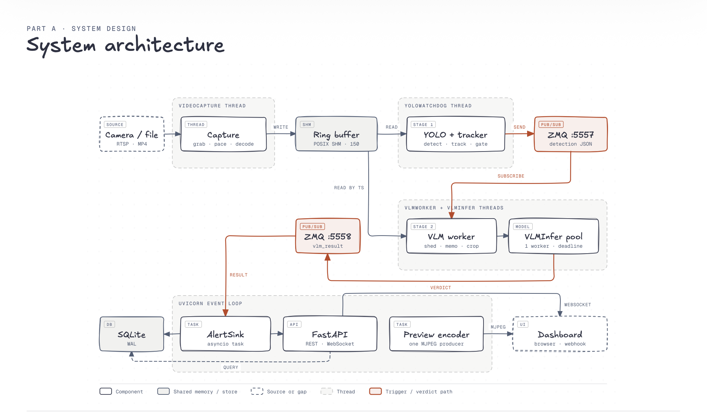

<div align="center">

# Eye-Q

**Plain-English alerts for ordinary IP cameras: a two-stage edge AI video pipeline.**


</div>

---

## Overview

Eye-Q watches a video source and answers plain-English questions about it, such as *"Is this person
bending over?"* or *"Is this person missing a hi-vis vest?"*. It records an alert whenever the answer
is **yes**. You don't need to train a model, label a dataset, or call a cloud service.

The whole design comes from one measurement:

| Stage | Model | Cost per call |
|---|---|---|
| Stage 1 | YOLOv8n object detection + tracking | **~16 ms / frame** |
| Stage 2 | Moondream 2B vision-language model (4-bit) | **~1,900 ms / verdict** |

The two stages are three orders of magnitude apart. A VLM cannot keep up with a 30 FPS stream, so
Eye-Q is a **cascade**: a cheap detector looks at every frame, and a slow, smart model looks at almost
nothing. Most of the codebase decides which subjects deserve a question, which questions are already
answered, and which can be dropped without missing anything that matters.

```
30 FPS of pixels ──▶ [YOLO: is there a person?] ──▶ ~0.1 FPS of subjects ──▶ [VLM: is this a violation?]
                         runs on everything                                   runs on almost nothing
```

Eye-Q runs as a single local process on a laptop or an edge device.

---

## Architecture



| Component | Role |
|---|---|
| **Capture** | Grabs, paces and decodes RTSP, MP4 or webcam frames on its own thread. Video files loop seamlessly, so a clip behaves like a live camera. |
| **Ring buffer** | A zero-copy POSIX shared-memory ring (150 slots). Writes overwrite and never wait, and readers are lock-free. |
| **Stage 1: YOLO watchdog** | Detects, tracks (greedy IoU) and gates subjects, then publishes JSON detection events on ZMQ `:5557`. |
| **Stage 2: VLM worker** | Subscribes to detections, re-reads the exact frame from the ring buffer **by timestamp**, crops the subject, and asks the VLM. It sheds stale triggers, coalesces bursts, and memoises verdicts. |
| **VLMInfer pool** | A single-worker executor with a hard deadline, so a wedged model can never stall the worker. |
| **AlertSink** | An asyncio task that consumes `vlm_result` events from ZMQ `:5558`, persists them to SQLite (WAL), and pushes them over WebSocket and webhook. |
| **FastAPI + preview encoder** | REST and WebSocket control plane, plus one shared MJPEG producer that serves every viewer. |

Two design rules hold the system together:

- **ZMQ carries JSON metadata only, never pixels.** Stage 2 reads frames from shared memory itself.
- **A slow VLM never drops a video frame.** Every hop is non-blocking: buffer writes overwrite,
  ZMQ sends drop at the high-water mark, and inference runs behind a deadline. When Stage 2 falls
  behind, fewer questions get answered, but capture never stops.

---

## Features

- **Open-vocabulary rules.** Write a rule as a yes/no question in plain English, optionally
  scoped to the YOLO classes it applies to (for example, `person`).
- **Per-subject tracking.** Each tracked subject is judged once and re-judged only when it moves
  or its verdict expires.
- **Four-layer load control.** Coalesce, shed, memoise and truncate, all tunable with one
  operator-facing formula: `duty_cycle = subjects × inference_s ÷ ttl`.
- **Focused crops.** Each question sees the subject's own box, so a neighbour can't flip the verdict.
- **Swappable VLM backends.** `moondream4bit` (default), `moondream`, `transformers`, or any
  `openai_compat` server such as Ollama, selected with one environment variable.
- **Conservative verdict parsing.** An ambiguous answer is read as "no violation", because alert
  fatigue is a worse failure than a missed alert.
- **Live dashboard.** Shows an annotated MJPEG feed, a rule editor, a real-time alert feed with
  evidence snapshots, and pipeline telemetry.
- **Webhooks.** Violations can be POSTed to any HTTP endpoint.
- **Observability.** `/api/status` exposes every filter and drop counter in the pipeline.

---

## Requirements

- **Python 3.13+** and [**uv**](https://docs.astral.sh/uv/)
- Apple Silicon (MPS), an NVIDIA GPU (CUDA), or CPU only
- About 2 GB of disk for model weights. YOLOv8n and the Moondream 2B 4-bit model download
  automatically on first run.

---

## Quickstart

```bash
git clone https://github.com/VishvakR/Eye-Q.git
cd Eye-Q
uv sync                      # on NVIDIA hardware: uv sync --extra cuda
```

Run the full appliance (capture, YOLO, VLM and dashboard):

```bash
uv run python main.py                                          # default webcam
uv run python main.py --source rtsp://192.168.1.100:554/stream1  # IP camera
uv run python main.py --source /path/to/video.mp4              # video file
```

Then open the dashboard at **http://localhost:8000**.

| Flag | Purpose |
|---|---|
| `--source` | RTSP URI, file path, or webcam index |
| `--host`, `--port` | API server bind address and port |
| `--device` | Stage 1 inference device: `auto`, `mps`, `cuda` or `cpu` |
| `--no-vlm` | Stage 1 only. Skips the VLM load for a fast startup. |
| `--api-only` | Dashboard and API only, with no video pipeline |

`uv run eyeq` is an equivalent entry point.

---

## Demo

`demo_cctv.py` runs the full pipeline against a 17-second warehouse CCTV clip (staff in hi-vis
vests packing cartons) and seeds rules tuned for that footage. The clip is not included in the
repository, so place your own `cctv_demo.mp4` in the project root first.

```bash
uv run python demo_cctv.py            # Full cascade + dashboard on :8000
uv run python demo_cctv.py --stage1   # Stage 1 only: no VLM load
uv run python demo_cctv.py --window   # Native OpenCV window instead of the browser
uv run python demo_cctv.py --reset    # Start from an empty alert log
```

The demo writes to `data/demo.db` and `data/demo_snapshots/`, so it never touches a real
deployment's alert history.

---

## Writing Rules

- **Phrase each question so "Yes" means trouble.** A yes answer is recorded as a violation and shown
  in red. *"Is this person wearing a vest?"* would flag every compliant worker. Ask
  *"Is this person missing a high-visibility vest?"* instead.
- **Ask one thing per rule.** With a compound question such as *"bending over or leaning across
  the table?"*, the model picks a branch instead of answering yes or no. Split it into two rules.
- **Ask what the camera can resolve.** If a worker's head is about 20 px tall, a hard-hat question
  can't be answered reliably, whatever the phrasing.
- **Scope each rule to the classes it concerns.** If a rule has no labels, the dashboard suggests
  matching YOLO classes when you save it.

---

## Configuration

Every setting is a `pydantic-settings` field with the prefix `EYEQ_`. You can set them as
environment variables or in a `.env` file. Each field's description in
[`app/config/settings.py`](app/config/settings.py) explains its trade-off and is the full reference.

| Variable | Default | Description |
|---|---|---|
| `EYEQ_DEFAULT_SOURCE` | `0` | RTSP URI, file path, or webcam index |
| `EYEQ_TARGET_FPS` | `30` | Capture frame rate |
| `EYEQ_BUFFER_CAPACITY` | `150` | Ring-buffer slots (about 405 MB at 720p) |
| `EYEQ_WATCHDOG_FPS` | `30.0` | Stage 1 rate. This is the main CPU lever. |
| `EYEQ_YOLO_CONFIDENCE` | `0.25` | Detection confidence threshold |
| `EYEQ_DEVICE` | `auto` | Stage 1 device. Under `auto` it gives the accelerator to an in-process VLM. |
| `EYEQ_VLM_BACKEND` | `moondream4bit` | `moondream4bit` \| `moondream` \| `transformers` \| `openai_compat` |
| `EYEQ_VLM_DEVICE` | `auto` | Stage 2 device |
| `EYEQ_VLM_VERDICT_TTL_S` | `300.0` | How long a subject's verdict is reused. `0` disables reuse. |
| `EYEQ_VLM_STALENESS_S` | `5.0` | Triggers older than this are shed |
| `EYEQ_VLM_API_BASE` | `http://127.0.0.1:11434/v1` | Endpoint for the `openai_compat` backend |
| `EYEQ_ENABLE_VLM` | `true` | `false` runs Stage 1 only |
| `EYEQ_API_PORT` | `8000` | Dashboard and API port |
| `EYEQ_DATABASE_PATH` | `data/eyeq.db` | SQLite alert store |
| `EYEQ_WEBHOOK_URL` | *(none)* | Endpoint that receives violation alerts |
| `EYEQ_LOG_LEVEL` | `INFO` | Log verbosity |

---

## API

| Method | Path | Purpose |
|---|---|---|
| `GET` | `/` | Dashboard |
| `GET` | `/api/stream/{camera_id}.mjpg` | Live annotated MJPEG stream |
| `GET` · `POST` · `DELETE` | `/api/rules` | List, create, or bulk-clear rules |
| `GET` · `PUT` · `DELETE` | `/api/rules/{id}` | Read, update, or delete a rule |
| `GET` | `/api/labels?prompt=` | YOLO vocabulary and suggested labels for a prompt |
| `GET` | `/api/alerts?limit&offset&rule_id` | Paginated alert history |
| `GET` · `POST` · `DELETE` | `/api/cameras` | Camera registry |
| `GET` | `/api/status` | Full pipeline telemetry and counters |
| `WS` | `/ws/events` | Live alert push |

---

## Project Structure

```
Eye-Q/
├── app/
│   ├── api/            # FastAPI server; the lifespan owns every component
│   ├── config/         # Settings (pydantic-settings, EYEQ_ prefix)
│   ├── core/           # Ring buffer, capture, ZMQ IPC, SQLite, overlays, ROI, labels
│   ├── pipelines/      # YOLO watchdog, IoU tracker, VLM worker, backends, verdict parser
│   ├── schemas/        # Wire contracts for ZMQ events
│   └── services/       # Alert sink, webhook dispatcher
├── frontend/           # Vanilla JS dashboard, no build step
├── bench/              # Latency, accuracy and load-replay benchmarks
├── tests/              # pytest suite
├── assets/             # README images
├── main.py             # Appliance entry point
├── demo_cctv.py        # Seeded warehouse CCTV demo
├── demo.py             # Stage 1 visual runner
└── ARCHITECTURE.md     # Engineering reference
```

---

## Testing

```bash
uv run pytest -m "not slow"          # Fast suite: no camera, no model downloads
uv run pytest                        # Includes tests that load the real YOLO and Moondream models
uv run ruff check app tests bench    # Lint
```

To measure VLM load under realistic identity churn, run:

```bash
uv run python bench/replay_load.py --duration 300 --loop
```

---

## Further Reading

[**ARCHITECTURE.md**](ARCHITECTURE.md) is the engineering reference. It covers threading and
ownership, how a frame becomes an alert, load control, the VLM backends, data contracts, and the
measured results behind each default.
